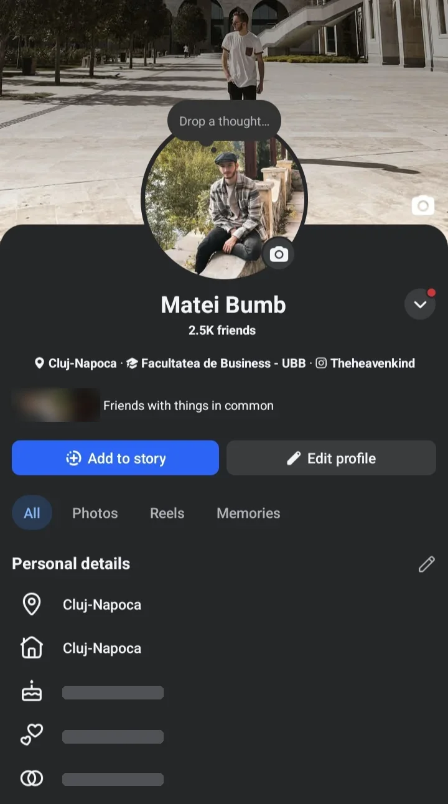

# Harvest improvements

> **Source:** Matei's Craft page "harvest improvements", copied 3 Nov 2026 (page last edited 3 Nov 2026, 14:02 CET).
> This is a work list for Claude Code. Matei's wording below is kept verbatim.
>
> **Standing rules apply:** pull the latest branch before you start, and never force-push over anyone else's commits.
>
> The screenshot lives at `docs/prd/screenshots/improvements/` (WebP) because the line-endings test (#575) accepts WebP images there by directory. Its birthday, relationship and gender rows and the friends' faces were masked because this repo is public; the layout is unchanged.

## Needs attention now (added 3 Nov 2026)

1. [ ] **Settings > Campus setup:** remove the onboarding questions; the Sign-up page replaces them.
2. [ ] **Settings > Social accounts** says it's not set up / not open for this account even on the top (Ministry) plan. Cause found: `hasSocialFullAccess` in `src/lib/social/access.ts` never checks the tenant owner (`ownerId`); it only allows super admin, verified email on `tenant_private.adminEmails`, role `church_admin`, or `permissions.fullAccess`. Owners must always have access: add `ownerId === uid` there and in the matching nav `hasFullAccess` check. `ZERNIO_SOCIAL_LIVE=1` is already set in Vercel production.
3. [ ] **Sidebar top, next to the logo:** Matei's words: "always keep eden, not the name of the user ministry". Don't show the ministry's name there. *Claude: confirm with Matei whether he means the Eden-style product brand (The Harvest).*
4. [ ] **Public page:** move Products into the Website section.
5. [ ] **Communities and Discovery** at the top, under Home.
6. [ ] **Remove the "Channels" group name;** put Newsletter under "Engage", in this order: Newsletter, Events, Forms, Sign up pages, Check in.
7. [ ] **Hide AI Knowledge** everywhere for now.
8. [ ] **Bug:** clicking an item on the public side opens it, but the active sidebar tab jumps to People.
9. [ ] **Default community** must use the same style as communities the owner creates, and every created community must have the same features as the default.
10. [ ] **Top-right "Community" switcher** dropdown must list all communities the owner created.
11. [ ] **Discovery page per community** (like Skool) isn't built yet for all communities.
12. [ ] **Storefront / link in bio** must be finished.
13. [ ] **Products > New product:** remove "Community" as a product type (communities have their own section).

**Future item (not now):** Eden-style email one-time-code sign-in (enter email, get code, paste, signed in). Prefer Neon Auth / Better Auth email OTP, since we're moving to Neon. Until the migration, mint a Firebase custom token after verifying the code. Keep password users working during the transition. Rate-limit code sends.

---

## Original Craft page

Sign in by code through email only.

Link in bio looks like a Facebook profile

Cover image

Profile image

Social links 

Personal relevant info

Then different tabs such as: 

- home
- Blog
- Partnership
- Etc.
