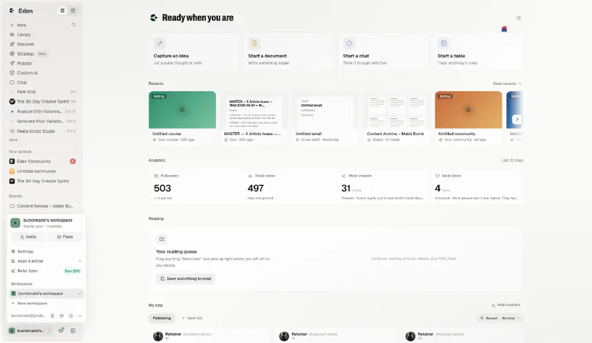
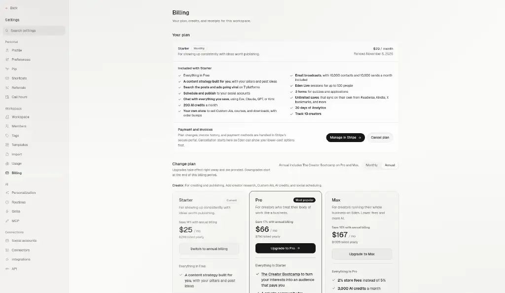
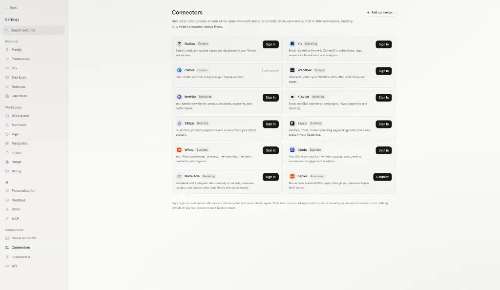
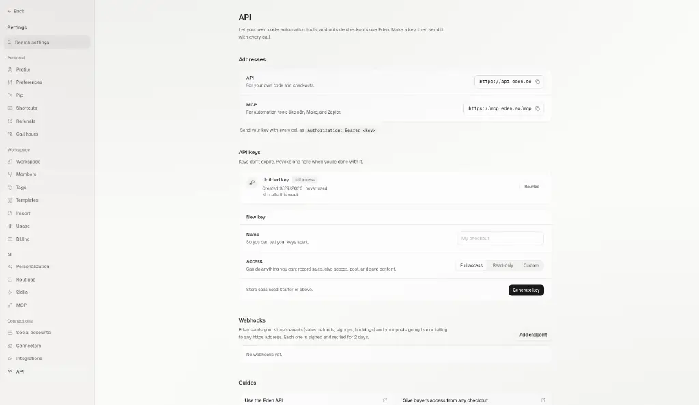

# The Harvest — Product Requirements Document

**Product:** The Harvest (theharvest.app) — a multi-tenant ministry SaaS platform
**Founder:** Matei Bumb
**Repo:** `bumbmatei-sys/Harvest-agent`
**Status:** Working draft, compiled from the live codebase (`main` @ `595269c`), `AGENTS.md`,
the screenshot inventory at `/workspace/prd/screens.json`, and the decision briefs under
`/workspace/grokpr/*.md`.
**How to read this document:** every functional requirement below is either (a) grounded in
code that exists today and cites a file path, (b) grounded in a decision already written down
in a brief and cited as such, or (c) explicitly flagged as a **proposal** and added to that
section's Open Questions. Nothing here is invented fact dressed up as a decision.

> **A note on terminology.** User-facing copy says **"Ministries,"** never "churches" — a tenant
> can be a church, a campus ministry, a youth outreach, a missions team, or any evangelistic
> organization. This document uses "ministry" and "tenant" interchangeably for the organization
> that signs up, and "owner/admin," "member," and "visitor" for the three faces of the product.

## Table of contents

1. [Vision, positioning & personas](#1-vision-positioning--personas)
2. [Accounts & tenancy](#2-accounts--tenancy)
3. [Plans, billing & checkout](#3-plans-billing--checkout)
4. [Onboarding](#4-onboarding)
5. [Communities](#5-communities)
6. [Community join & CRM](#6-community-join--crm)
7. [Events](#7-events)
8. [Events + Communities integration](#8-events--communities-integration)
9. [Forms & Sign-ups](#9-forms--sign-ups)
10. [Products](#10-products)
11. [Link in bio](#11-link-in-bio)
12. [Newsletter](#12-newsletter)
13. [Website builder & public website](#13-website-builder--public-website)
14. [Social scheduler](#14-social-scheduler)
15. [AI assistant](#15-ai-assistant)
16. [UI system](#16-ui-system)
17. [Campaigns, giving, dashboard & settings](#17-campaigns-giving-dashboard--settings)
18. [Architecture & future (Firebase → Neon)](#18-architecture--future-firebase--neon)
19. [Security, privacy & compliance](#19-security-privacy--compliance)
20. [Non-functional requirements, analytics & roadmap](#20-non-functional-requirements-analytics--roadmap)
21. [Open questions for Matei](#21-open-questions-for-matei)

Screenshots for each section live in `docs/prd/screenshots/<section>/` next to this file.
Every image caption states whether it is an **Eden reference** (the design Harvest is copying),
current **Harvest UI**, or a **market reference** (a third product used for inspiration, e.g.
Skool, Luma, Framer link-in-bio sites) — and whether it was captured at desktop or mobile width.

---

## 1. Vision, positioning & personas

### 1.1 What The Harvest is

The Harvest is a multi-tenant SaaS platform, built for ministries the way **Eden** (a
creator-economy "everything app" — store, community, newsletter, link-in-bio, social
scheduling, AI) is built for creators. A ministry signs up once and gets one workspace that
can run its outreach, its community, its events, its giving, and its communications, instead
of stitching together a form tool, a Mailchimp account, a Facebook group, a Calendly link, and
a separate giving page.

The product deliberately follows Eden's shell, interaction patterns, and information
architecture ("Eden parity" is called out per-section below) because Eden has already solved
the UX problems of "one creator, many surfaces, one inbox" — and a ministry admin has the same
shape of problem as a creator: one person (or a small team) managing a store, a community, and
an audience, from a phone, between other responsibilities.

### 1.2 The evangelism loop this product is built around

The product's central growth loop, repeated throughout this document, is:

**QR code at an outreach event → a short public form or sign-up page → an after-submit card that
invites the visitor into a community (or a product) → the visitor becomes a CRM contact the
ministry can follow up with.**

Concretely: a ministry prints a QR code (every form and sign-up page gets one — see
[§9](#9-forms--sign-ups)) and puts it on a table at a street outreach, a conference booth, or a
Sunday bulletin. A visitor scans it, lands on a mobile-first public page
(`theharvest.app/form/[formId]` or `/s/[handle]`), fills in name/email/answers, and — because the
admin configured "after submit, show a community" — immediately sees a Discover-style card
inviting them to join the ministry's community ([§9.4](#94-after-submit-card)). Joining creates a
CRM contact automatically ([§6](#6-community-join--crm)), so the ministry never loses the lead
even if the visitor never comes back on their own.

This loop is why QR codes are on **every plan including Free**, why Free includes Communities
and Sign-ups despite having no dashboard, and why the after-submit card and the CRM are treated
as core infrastructure rather than "nice to have" add-ons.

### 1.3 Personas

| Persona | Who they are | What they need from Harvest |
|---|---|---|
| **Ministry owner** | The founder/lead pastor/ministry director who signs the Dodo subscription (or stays on Free). Usually not deeply technical. | A workspace that feels like one product, not a bundle of tools; a way to see every lead and member in one CRM regardless of which community or form they came through; confidence that billing, giving and member data are handled honestly (see the money-model invariants in `AGENTS.md`, reflected throughout this PRD). |
| **Admin / team member** | Staff or volunteers an owner invites in (see [§17.4](#174-teamadmin-roles)). Runs day-to-day community moderation, event check-in, form follow-up. | Scoped permissions so they can do their job (CRM, check-in, content) without seeing billing or being able to delete another admin's contacts ([§6.6](#66-erasure--consent)). |
| **Member** | Someone who joined a community, registered for an event, or subscribed to a newsletter. Reached through the mobile-first member app. | A clear, honest picture of what they joined, the ability to leave a community without their history being erased outright, and a consent notice that tells them plainly what the ministry can see and do with their information. |
| **Visitor** | Anyone who is not yet a member — the person scanning the QR code. Has no account yet. | A fast, mobile-first path from "I scanned a code" to "I'm in" with no sign-up friction before they've decided they want in; a public page that does not ask for a subdomain, a plan, or anything else irrelevant to "I want to learn more." |

### 1.4 Eden parity note

Every later section has its own Eden-parity note, but the overview is: Eden's **Store, Library,
Community, Discover, Newsletter, Link-in-bio, Calendar, and Publish (social scheduler)** surfaces
each map to a Harvest equivalent (Products, Courses/Notes, Communities, Discover, Newsletter,
Link in bio, Coaching/booking, Social scheduler). Harvest does not copy Eden's creator-specific
surfaces that have no ministry analogue (e.g. Eden's brand-deal/sponsorship tooling), and
several Eden-shaped features exist in the Harvest UI already but are explicitly **not planned**
or **gated off** today — Auto-DM automations and several "other Eden product types" (cohorts,
workshops, Ask-me, Custom AI as a sellable product) are called out as reference-only in
[§10](#10-products) and [§14](#14-social-scheduler), not commitments.

### 1.5 Screenshots

This section is conceptual and does not have its own screenshot set. The Eden surfaces that
define the product's positioning — Discover and the overall app shell — are captured in full
in [§5 Communities](#5-communities) (Discover) and [§16 UI system](#16-ui-system) (shell,
sidebar, navigation). Every screenshot in this document's inventory is an Eden reference image
(the design Harvest is copying), labelled per-section as it is embedded.

### 1.6 Open questions
See [§21](#21-open-questions-for-matei) items tagged **Vision**.

---

## 2. Accounts & tenancy

### 2.1 Goal
One Firebase Auth account should be able to **own** a ministry's workspace and separately
**join**, as a member, any number of other ministries' communities — without ever being asked
for a subdomain unless and until it chooses to publish a public website.

### 2.2 Users / roles
Ministry owner (one tenant), admin/team member (scoped to one tenant via `manageX`
permissions), member (can hold a `memberships/{tenantId}` entry for many tenants
simultaneously), visitor (no account).

### 2.3 How tenancy resolves today (grounded in code)
- A tenant is a document at `tenants/{tenantId}`. A user's **owning** tenant is the single
  `tenantId` field on `users/{uid}` (`src/lib/set-custom-claims.ts:24`), minted into a Firebase
  custom claim (`{ tenantId, admin, superAdmin }`) by `src/lib/set-custom-claims.ts`. One user
  document can own exactly one tenant — this is the admin/owner relationship, and it is
  deliberately singular (an owner runs one ministry's dashboard).
- A tenant is resolved **from the hostname** on four independent code paths that AGENTS.md
  requires to be kept in sync: `getTenantIdFromHost()` (`src/utils/tenant-scope.ts`),
  `resolveTenantIdFromHostname()` (`src/contexts/TenantContext.tsx:237`), `getTenantFromHost()`
  (`src/lib/server-tenant.ts`), and `AuthPage`'s own derivation. Today that resolution is
  **subdomain-based**: `<slug>.theharvest.app` maps to `tenants/{slug}`.
- **Membership is separate from ownership and is already multi-tenant.** `POST
  /api/community/join` (`src/lib/community-membership-api.ts`) writes two documents per join:
  `tenants/{tenantId}/communityMembers/{uid}` (the ministry's own roster) and
  `users/{uid}/memberships/{tenantId}` (the member's own index). Because the index is keyed by
  `tenantId`, **one account genuinely can hold a `memberships/{tenantId}` entry for many
  different ministries at once** — the join/leave code has no concept of "already a member of
  a different community" blocking a new join. A second, newer index
  (`membershipIndexId(tenantId, communityId) = "{tenantId}__{communityId}"`,
  `src/lib/community/communities.ts:51`) extends this to **non-default communities within a
  tenant** — see [§5](#5-communities) for why a single tenant can run more than one community.
- **A campus is not a second tenant.** Per `AGENTS.md`, a multi-campus ministry is one tenant,
  one subdomain, one subscription; campuses are counted by `maxChurches` and are unlimited on
  every paid tier, zero on Free. Do not confuse "a ministry owns several communities" (true,
  within one tenant) with "a ministry owns several tenants" (not a supported shape — provisioning
  a second tenant for a second campus is explicitly the anti-pattern `AGENTS.md` warns against).

### 2.4 Required direction: no subdomain at sign-up, on any plan
This is the decided product direction, stated directly in the brief for this document, and it
is **not yet what the code does**:

- **Required:** every tenant's app lives at `theharvest.app` (no subdomain) until the ministry
  explicitly publishes a public website ([§13](#13-website-builder--public-website)); claiming a
  subdomain happens exclusively as part of that publish action, on whichever plan allows a
  published site. No plan's sign-up flow asks for or allocates a subdomain.
- **What exists today:** `ChurchOnboarding.tsx` asks every signup — Free included — to "Choose
  your web address" (`isFree` branch, `src/components/ChurchOnboarding.tsx:395`) and checks
  subdomain availability live (`isSubdomainAvailable`); `FirstRunSetup.tsx` repeats a subdomain
  step after a paid signup; and `src/app/api/tenants/save/route.ts` still requires
  `{ name, subdomain }` to provision a tenant record. `WorkspaceHandoff.tsx` — the "your payment
  went through" screen — exists specifically because the paid flow already hard-redirects the
  owner to `<tenant>.theharvest.app` the moment the webhook provisions, which is a second origin
  Firebase Auth cannot carry a session across. All of this machinery assumes a subdomain exists
  from minute one.
- **Consequence of the fix:** removing the subdomain step from sign-up removes the
  origin-crossing problem `WorkspaceHandoff.tsx` was built to soften (owner and admin both stay
  on `theharvest.app` until they choose to publish), but `WorkspaceHandoff.tsx`'s underlying
  purpose — telling someone who just paid where their account is — still applies in whatever
  form the post-payment landing takes.
- **Existing subdomains keep working.** A tenant that already has a subdomain (every tenant
  provisioned under the current flow) must keep resolving exactly as it does today; this is an
  additive change to how *new* tenants are created, not a migration of existing ones.

### 2.5 Tenant isolation
- Every tenant-scoped Firestore read/write must resolve a real `tenantId` before it runs.
  **Super admin's own `tenantId` is `null`** (`AGENTS.md`) — any code path that forgets to check
  this writes to `tenants/null/...`. This is a standing trap flagged in `AGENTS.md`, not a
  theoretical one.
  **`firestore.rules` auto-deploys to production on any merge that touches it** — a rules
  change proposed anywhere in this PRD (e.g. new community sub-resources) needs its own founder
  sign-off before it ships, independent of the app code around it.
- Firestore rules cannot filter a `list` query per-document — a rule that reads `resource.data`
  rejects the whole query unless the query's own `where` clause already constrains that field.
  Every tenant-scoped list in this product must be written with that constraint from the start,
  not patched in after a silent empty-list bug.

### 2.6 Data model notes
- `users/{uid}`: `{ tenantId, role, email, displayName, ... }` — the owning tenant, if any.
- `tenants/{tenantId}`: the workspace; `plan`, `addons`, `status`, `config` (giving links, etc.).
- `users/{uid}/memberships/{tenantId}`: this account's membership status in that tenant's
  default community — `{ tenantId, status, joinedAt, leftAt }`.
- `tenants/{tenantId}/communityMembers/{uid}`: the ministry's own roster entry for that member.
- `tenants/{tenantId}/communities/{communityId}`: a non-default community belonging to this
  tenant (see [§5](#5-communities)).

### 2.7 Edge cases
- An owner who is also a member elsewhere: the owner's custom claim still names only their own
  tenant; their *membership* elsewhere is tracked the same way any member's is, through the
  `memberships` index — owning and joining are not mutually exclusive for one account.
- A tenant with no subdomain yet (once §2.4 ships) and no published website: it must still be
  fully reachable and usable at `theharvest.app` with the signed-in user's tenant resolved from
  their custom claim, not from the hostname, since there is no tenant-specific hostname yet.
- A super admin acting on a specific tenant must always pass an explicit `tenantId`; nothing may
  infer one from a `null` claim.

### 2.8 Mobile
Hostname-based resolution and claim-based resolution behave identically on mobile web and in
the Capacitor-wrapped app; there is no separate mobile tenancy model.

### 2.9 Acceptance criteria
- A brand-new Free or paid signup never sees a subdomain field, a "choose your web address"
  step, or a `*.theharvest.app` availability check anywhere before or during account creation.
- An account that owns Tenant A can join Tenant B's and Tenant C's communities as a member, and
  each membership is independently joinable/leavable without affecting the others.
- Every existing tenant's subdomain keeps resolving exactly as today after this ships.

### 2.10 Open questions
See [§21](#21-open-questions-for-matei) items tagged **Tenancy**.

---

## 3. Plans, billing & checkout

### 3.1 Goal
Three tiers — **Free, Church, Ministry** — sold through Dodo Payments (the only live billing
rail; Stripe's platform account was closed as `rejected.fraud` and is not coming back), with
checkout that never advances a signup on an unverified claim of payment.

### 3.2 Users / roles
Ministry owner (buys/changes/cancels the subscription), admin (can view plan/billing per role
grant), Harvest super admin (support, reconciliation).

### 3.3 The three tiers, grounded in code
- Tier ids are `free`, `church`, `ministry` (displayed Free, Church, Ministry) —
  `src/utils/plan-features.ts` (`PLAN_FEATURES`, `PLAN_PRICING`, `PLAN_FEES`). This document does
  not restate the price/cap table, in keeping with `AGENTS.md`'s own rule: a table here would go
  stale the moment a price changes, and the test suite (`src/utils/plan-features.ts` consumers,
  plus a cross-repo contract with the marketing site) is the only thing allowed to own the
  numbers.
- **Free is not a zero-priced row** — it is absent from `PLAN_PRICING` entirely, has no billing
  term, and `planPriceUsd('free', …)` is a compile error by design. Free is capped at the same
  contact count as the cheapest paid tier; per `AGENTS.md` (THE-370), "Church is now bought for
  capability, not capacity" — a free tenant is sized for one evangelist's personal discipleship,
  not a multi-campus ministry (one admin, one adopted course, no feed, no giving page, zero
  campuses).
- **Three retired plan ids (`plus`, `pro`, `max`) can still be sitting on old tenant/user/Dodo
  records.** They are normalised at read time through `canonicalPlanId` — never compare a raw
  stored `plan` string to a tier id without going through it first.
- **Billing terms are `monthly` and `yearly` only** (`BILLING_TERMS`). A `quarterly` term was
  withdrawn 2026-10-23 and its Dodo products archived; a stale `?billing=quarterly` link falls
  back to monthly. Dodo's own vocabulary says `annual` where Harvest says `yearly` —
  `src/lib/dodo/catalogue.ts` is the one place that reconciles the two words.
- **There are exactly four add-ons**: AI Assistant, Admin Seats, Unlimited Contacts, Social
  scheduler. Social scheduler's add-on exists as a field but has no Dodo product attached yet —
  it is not purchasable today even though the plumbing (`TenantAddons`) is there.
- **The webhook is the single writer of `tenants/{id}.plan`.** No client code may write that
  field under any circumstance — this is swept by dedicated tests per `AGENTS.md`.

### 3.4 Checkout must verify real payment status server-side
- **Required:** the `?dodo=success` query parameter is a UX hint for which screen to render,
  never evidence that money moved. The only trustworthy signal is the Dodo webhook's
  `subscription.active` event, which is what provisions the tenant document and sets
  `onboardingCompleted: true`.
- **What the code already does right:** this separation already exists in spirit.
  `WorkspaceHandoff.tsx` does not re-trust the URL; it polls `tenants/{tenantId}` by document ID
  (a world-readable `get`, not a query) until the tenant document the webhook creates actually
  exists, and only then shows a "continue" action — `readPendingPaymentConfirmation` only decides
  *which copy* to show ("Payment received" vs "Account created"), never whether to proceed.
  `isReturningFromCheckout` (`src/utils/signup-checkout.ts`) is similarly scoped to "which screen
  renders," not "was this person charged."
- **What's missing against this PRD's brief:** there is no shadcn "Payment didn't go through"
  state with **Try again / Choose another plan** actions. The only failure path that exists
  today is `WorkspaceHandoff`'s stalled branch (after **180 seconds**, not the 60 seconds asked
  for here) — and that branch assumes the payment *succeeded* and provisioning is merely slow; it
  offers "Contact support," never a retry, because — correctly — nothing on a post-charge screen
  may trigger a second charge. A genuinely **declined/failed** payment (Dodo reports failure,
  not just "provisioning is slow") has no distinct UI today and needs one: a declined checkout
  must be told apart from a slow-but-succeeding one, shown the "didn't go through" state with
  Try again / Choose another plan, and must leave **no tenant or slug reserved** — nothing should
  be claimed, and definitely no subdomain (see [§2.4](#24-required-direction-no-subdomain-at-sign-up-on-any-plan)),
  until a `subscription.active` webhook actually lands.
- **Proposal (add to Open Questions):** a 60-second *pending* timeout — distinct from the
  existing 180-second *stalled-but-paid* timeout in `WorkspaceHandoff` — should apply only before
  any webhook has fired at all, i.e. while it is still ambiguous whether the charge even went
  through on Dodo's side. Once a webhook is known to be en route (payment confirmed, tenant
  provisioning in progress), the longer, no-retry-affordance stall screen is correct and should
  not be shortened.

### 3.5 Free plan shell
Free gets Discover, Communities, Sign-ups and Forms, but no admin dashboard and no subdomain.
It still needs an account menu — name, email, Sign out — somewhere reachable from the Free
member-facing shell, since a Free user has an account even without a dashboard.

### 3.6 Eden parity
Eden's own Settings → Plan/Billing surface (account, connectors, integrations, API keys) is the
shell this section's screenshots are drawn from; Harvest's plan/billing settings should match
its layout and information density, substituting Dodo for Eden's own billing provider and
dropping surfaces Harvest doesn't have (e.g. Eden's third-party connector marketplace).

### 3.7 Data model notes
`tenants/{id}.plan` (webhook-only), `tenants/{id}.addons` (`TenantAddons`), Dodo
subscription/customer ids stored on the tenant doc, `PLAN_FEES` for the ministry's own cut on
product sales (donations carry no fee on any tier; product sales are gated off entirely by
`PAID_PRODUCT_CHECKOUT_ENABLED = false` today, so every surface that prints a product-sale rate
must also print "coming soon").

### 3.8 Edge cases
- A webhook that double-fires must not double-provision or double-charge; idempotency keys off
  the Dodo event/subscription id.
- A plan downgrade that would put a tenant over a new, lower cap (contacts, communities,
  campuses) must not silently delete data — see the `UNLIMITED_CAP = -1` sentinel note in
  `AGENTS.md`: any new comparison against a cap must special-case it or it will read a church as
  permanently over its limit.
- A legacy `plus`/`pro`/`max` tenant must see itself correctly as Church/Ministry everywhere,
  including on this billing screen, via `canonicalPlanId` — never a raw string compare.

### 3.9 Mobile
Plan/billing settings must be fully usable at mobile widths — this is an admin surface, but
admins frequently manage it from a phone between services.

### 3.10 Screenshots

<table><tr>
<td> Eden reference (design we copy) — desktop</td>
<td> Eden reference (design we copy) — desktop</td>
</tr><tr>
<td> Eden reference (design we copy) — desktop</td>
<td> Eden reference (design we copy) — desktop</td>
</tr></table>

The full set of 17 Eden plan/billing/settings reference screens for this section is in
`docs/prd/screenshots/03-plans-billing/` (see `_manifest.json` for the complete list and source
paths). All are desktop-only in the source material; no mobile Eden reference exists for this
surface, and no current Harvest UI screenshot is included per this document's screenshot policy
(Eden references only — see the top of this document).

### 3.11 Open questions
See [§21](#21-open-questions-for-matei) items tagged **Billing**.

---

## 4. Onboarding

### 4.1 Goal
Get a visitor from "I decided to sign up" to a usable workspace (Free) or a provisioned,
paid-for workspace (Church/Ministry) with the fewest possible decisions front-loaded — and,
per the direction in [§2.4](#24-required-direction-no-subdomain-at-sign-up-on-any-plan), with
**no church-name-as-subdomain step at all**.

### 4.2 Users / roles
The future ministry owner only; nobody else is present during onboarding.

### 4.3 Functional requirements
- **Required:** the sign-up flow collects what's needed to create the account and, for paid
  tiers, to start a Dodo checkout — and nothing about a subdomain or a public web address.
  Ministry name is still collected (it's the workspace's display name and the default
  community's name, per [§5.3](#53-the-default-community)), but it is not simultaneously
  doubling as a slug the visitor has to see validated against availability.
- **What exists today, and must change:** `ChurchOnboarding.tsx` currently branches on
  `isFree` into two lanes that both ask for a web address before anything else happens — Free's
  copy is literally "Choose your web address," and the paid lane repeats the same step in
  `FirstRunSetup.tsx` after payment, pre-filled with an auto-generated subdomain the owner can
  keep or change. Both lanes call `isSubdomainAvailable()` live as the visitor types. This is
  exactly the step [§2.4](#24-required-direction-no-subdomain-at-sign-up-on-any-plan) requires
  removing from onboarding; it does not disappear from the product, it moves to the website
  publish flow in [§13](#13-website-builder--public-website).
- Free's onboarding ends at a usable Free shell (Discover, Communities, Sign-ups, Forms) with no
  dashboard. Paid onboarding ends at `WorkspaceHandoff` (today's version, pending the
  [§2.4](#24-required-direction-no-subdomain-at-sign-up-on-any-plan) rework) confirming the
  charge and handing the owner into their workspace.
- Free's after-submit path can offer joining a community or a product immediately — this is the
  same after-submit card mechanism as forms ([§9.4](#94-after-submit-card)), applied to the
  sign-up flow itself.

### 4.4 Eden parity
No Eden reference screenshots are indexed in the restricted Eden image set for this section —
Eden does not have an equivalent "create your creator workspace" funnel captured in the
archive used for this document. This section is written from code and from `AGENTS.md`
directly; see the appendix in `docs/prd/README.md` for the list of sections with no screenshots.

### 4.5 Data model notes
`users/{uid}.onboardingCompleted`, `tenants/{id}.status`, the signup marker fields referenced in
`ChurchOnboarding.tsx` (`signupMinistryName`, `signupSubdomain` — the latter's name itself is a
holdover from the subdomain-at-signup model and should be revisited once §2.4 ships).

### 4.6 Edge cases
- A visitor who starts paid onboarding, is redirected to Dodo Checkout, and abandons it: no
  tenant, no slug, nothing reserved (same invariant as [§3.4](#34-checkout-must-verify-real-payment-status-server-side)).
- A Free signup that later wants to upgrade must not have to redo ministry-identity steps it
  already completed.

### 4.7 Mobile
Onboarding is frequently completed on a phone (a visitor deciding to sign up after scanning a
QR code is a mobile user by definition) — every step must be mobile-first, not a desktop flow
that happens to be responsive.

### 4.8 Acceptance criteria
- No onboarding path, Free or paid, presents a subdomain field, a web-address availability
  check, or any `*.theharvest.app` string before the workspace is created.
- A Free signup reaches a working Discover/Communities/Sign-ups/Forms shell with no dashboard
  and no subdomain.

### 4.9 Open questions
See [§21](#21-open-questions-for-matei) items tagged **Onboarding**.

---
