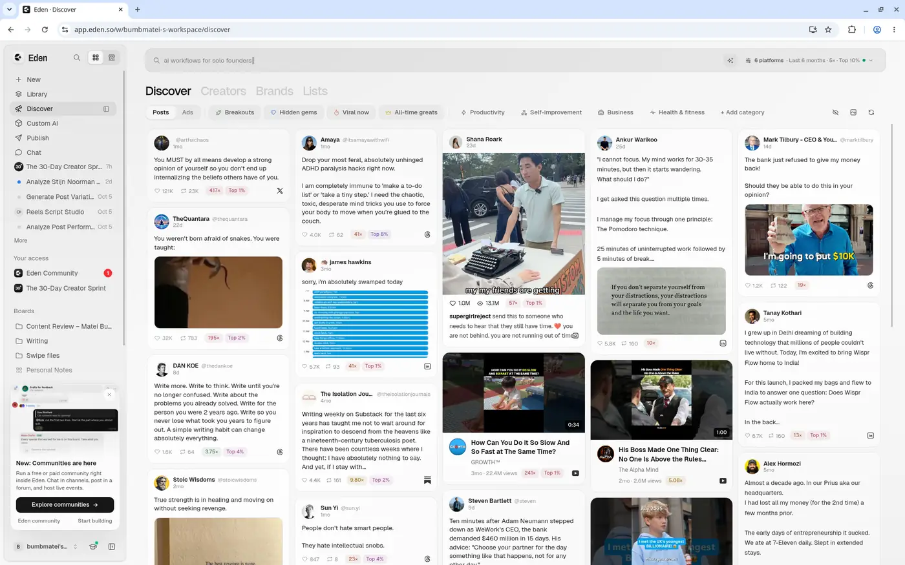
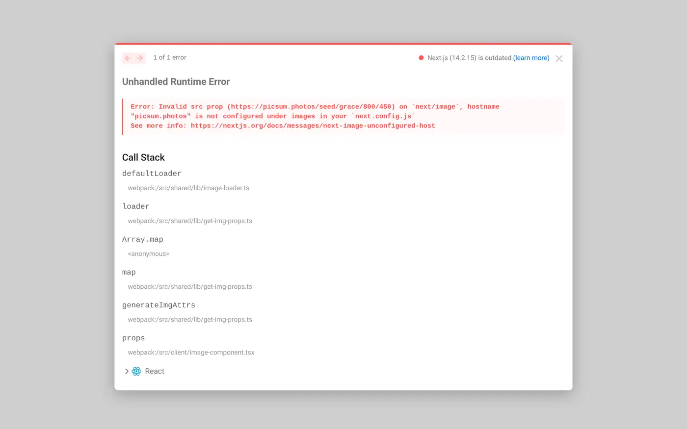
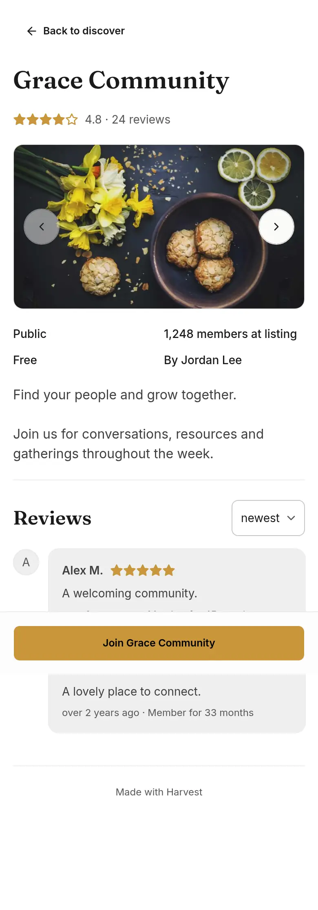
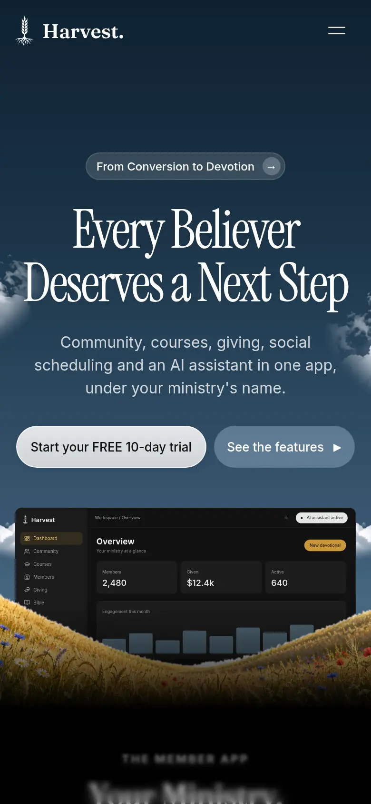

# The Harvest — Product Requirements Document

**Product:** The Harvest (theharvest.app) — a multi-tenant ministry SaaS platform
**Founder:** Matei Bumb
**Repo:** `bumbmatei-sys/Harvest-agent`
**Status:** Working draft, compiled from the live codebase (`main` @ `595269c`), `AGENTS.md`,
the screenshot inventory at `/workspace/prd/screens.json`, and the decision briefs under
`/workspace/grokpr/*.md`.
**How to read this document:** every functional requirement below is either (a) grounded in
code that exists today and cites a file path, (b) grounded in a decision already written down
in a brief and cited as such, or (c) explicitly flagged as a **proposal** and added to that
section's Open Questions. Nothing here is invented fact dressed up as a decision.

> **A note on terminology.** User-facing copy says **"Ministries,"** never "churches" — a tenant
> can be a church, a campus ministry, a youth outreach, a missions team, or any evangelistic
> organization. This document uses "ministry" and "tenant" interchangeably for the organization
> that signs up, and "owner/admin," "member," and "visitor" for the three faces of the product.

## Table of contents

1. [Vision, positioning & personas](#1-vision-positioning--personas)
2. [Accounts & tenancy](#2-accounts--tenancy)
3. [Plans, billing & checkout](#3-plans-billing--checkout)
4. [Onboarding](#4-onboarding)
5. [Communities](#5-communities)
6. [Community join & CRM](#6-community-join--crm)
7. [Events](#7-events)
8. [Events + Communities integration](#8-events--communities-integration)
9. [Forms & Sign-ups](#9-forms--sign-ups)
10. [Products](#10-products)
11. [Link in bio](#11-link-in-bio)
12. [Newsletter](#12-newsletter)
13. [Website builder & public website](#13-website-builder--public-website)
14. [Social scheduler](#14-social-scheduler)
15. [AI assistant](#15-ai-assistant)
16. [UI system](#16-ui-system)
17. [Campaigns, giving, dashboard & settings](#17-campaigns-giving-dashboard--settings)
18. [Architecture & future (Firebase → Neon)](#18-architecture--future-firebase--neon)
19. [Security, privacy & compliance](#19-security-privacy--compliance)
20. [Non-functional requirements, analytics & roadmap](#20-non-functional-requirements-analytics--roadmap)
21. [Open questions for Matei](#21-open-questions-for-matei)

Screenshots for each section live in `docs/prd/screenshots/<section>/` next to this file.
Every image caption states whether it is an **Eden reference** (the design Harvest is copying),
current **Harvest UI**, or a **market reference** (a third product used for inspiration, e.g.
Skool, Luma, Framer link-in-bio sites) — and whether it was captured at desktop or mobile width.

---

## 1. Vision, positioning & personas

### 1.1 What The Harvest is

The Harvest is a multi-tenant SaaS platform, built for ministries the way **Eden** (a
creator-economy "everything app" — store, community, newsletter, link-in-bio, social
scheduling, AI) is built for creators. A ministry signs up once and gets one workspace that
can run its outreach, its community, its events, its giving, and its communications, instead
of stitching together a form tool, a Mailchimp account, a Facebook group, a Calendly link, and
a separate giving page.

The product deliberately follows Eden's shell, interaction patterns, and information
architecture ("Eden parity" is called out per-section below) because Eden has already solved
the UX problems of "one creator, many surfaces, one inbox" — and a ministry admin has the same
shape of problem as a creator: one person (or a small team) managing a store, a community, and
an audience, from a phone, between other responsibilities.

### 1.2 The evangelism loop this product is built around

The product's central growth loop, repeated throughout this document, is:

**QR code at an outreach event → a short public form or sign-up page → an after-submit card that
invites the visitor into a community (or a product) → the visitor becomes a CRM contact the
ministry can follow up with.**

Concretely: a ministry prints a QR code (every form and sign-up page gets one — see
[§9](#9-forms--sign-ups)) and puts it on a table at a street outreach, a conference booth, or a
Sunday bulletin. A visitor scans it, lands on a mobile-first public page
(`theharvest.app/form/[formId]` or `/s/[handle]`), fills in name/email/answers, and — because the
admin configured "after submit, show a community" — immediately sees a Discover-style card
inviting them to join the ministry's community ([§9.4](#94-after-submit-card)). Joining creates a
CRM contact automatically ([§6](#6-community-join--crm)), so the ministry never loses the lead
even if the visitor never comes back on their own.

This loop is why QR codes are on **every plan including Free**, why Free includes Communities
and Sign-ups despite having no dashboard, and why the after-submit card and the CRM are treated
as core infrastructure rather than "nice to have" add-ons.

### 1.3 Personas

| Persona | Who they are | What they need from Harvest |
|---|---|---|
| **Ministry owner** | The founder/lead pastor/ministry director who signs the Dodo subscription (or stays on Free). Usually not deeply technical. | A workspace that feels like one product, not a bundle of tools; a way to see every lead and member in one CRM regardless of which community or form they came through; confidence that billing, giving and member data are handled honestly (see the money-model invariants in `AGENTS.md`, reflected throughout this PRD). |
| **Admin / team member** | Staff or volunteers an owner invites in (see [§17.4](#174-teamadmin-roles)). Runs day-to-day community moderation, event check-in, form follow-up. | Scoped permissions so they can do their job (CRM, check-in, content) without seeing billing or being able to delete another admin's contacts ([§6.6](#66-erasure--consent)). |
| **Member** | Someone who joined a community, registered for an event, or subscribed to a newsletter. Reached through the mobile-first member app. | A clear, honest picture of what they joined, the ability to leave a community without their history being erased outright, and a consent notice that tells them plainly what the ministry can see and do with their information. |
| **Visitor** | Anyone who is not yet a member — the person scanning the QR code. Has no account yet. | A fast, mobile-first path from "I scanned a code" to "I'm in" with no sign-up friction before they've decided they want in; a public page that does not ask for a subdomain, a plan, or anything else irrelevant to "I want to learn more." |

### 1.4 Eden parity note

Every later section has its own Eden-parity note, but the overview is: Eden's **Store, Library,
Community, Discover, Newsletter, Link-in-bio, Calendar, and Publish (social scheduler)** surfaces
each map to a Harvest equivalent (Products, Courses/Notes, Communities, Discover, Newsletter,
Link in bio, Coaching/booking, Social scheduler). Harvest does not copy Eden's creator-specific
surfaces that have no ministry analogue (e.g. Eden's brand-deal/sponsorship tooling), and
several Eden-shaped features exist in the Harvest UI already but are explicitly **not planned**
or **gated off** today — Auto-DM automations and several "other Eden product types" (cohorts,
workshops, Ask-me, Custom AI as a sellable product) are called out as reference-only in
[§10](#10-products) and [§14](#14-social-scheduler), not commitments.

### 1.5 Screenshots

<table><tr>
<td> Eden reference (design we copy) — desktop — Eden's Discover surface, the model for Harvest Discover</td>
<td> Harvest UI (current) — marketing site — desktop</td>
</tr><tr>
<td> Harvest UI (current) — desktop — community About builder</td>
<td> Harvest UI (current) — mobile — community About page</td>
</tr><tr>
<td> Market reference (Skool) — desktop — competitor Discover cards</td>
<td> Harvest UI (current) — marketing site — mobile</td>
</tr></table>

Additional captured screens for this section (Eden Discover/store maps, Skool About/reviews
reference, Framer-based ministry "About" pages used as market reference, and more Harvest
marketing-site crops) are in `docs/prd/screenshots/01-vision-positioning/` — see
`_manifest.json` in that folder for the full list with source paths.

### 1.6 Open questions
See [§21](#21-open-questions-for-matei) items tagged **Vision**.

---
