# The Harvest — Product Requirements Document

**Product:** The Harvest (theharvest.app) — a multi-tenant ministry SaaS platform
**Founder:** Matei Bumb
**Repo:** `bumbmatei-sys/Harvest-agent`
**Status:** Working draft, compiled from the live codebase (`main` @ `595269c`), `AGENTS.md`,
the screenshot inventory at `/workspace/prd/screens.json`, and the decision briefs under
`/workspace/grokpr/*.md`.
**How to read this document:** every functional requirement below is either (a) grounded in
code that exists today and cites a file path, (b) grounded in a decision already written down
in a brief and cited as such, or (c) explicitly flagged as a **proposal** and added to that
section's Open Questions. Nothing here is invented fact dressed up as a decision.

> **A note on terminology.** User-facing copy says **"Ministries,"** never "churches" — a tenant
> can be a church, a campus ministry, a youth outreach, a missions team, or any evangelistic
> organization. This document uses "ministry" and "tenant" interchangeably for the organization
> that signs up, and "owner/admin," "member," and "visitor" for the three faces of the product.

## Table of contents

1. [Vision, positioning & personas](#1-vision-positioning--personas)
2. [Accounts & tenancy](#2-accounts--tenancy)
3. [Plans, billing & checkout](#3-plans-billing--checkout)
4. [Onboarding](#4-onboarding)
5. [Communities](#5-communities)
6. [Community join & CRM](#6-community-join--crm)
7. [Events](#7-events)
8. [Events + Communities integration](#8-events--communities-integration)
9. [Forms & Sign-ups](#9-forms--sign-ups)
10. [Products](#10-products)
11. [Link in bio](#11-link-in-bio)
12. [Newsletter](#12-newsletter)
13. [Website builder & public website](#13-website-builder--public-website)
14. [Social scheduler](#14-social-scheduler)
15. [AI assistant](#15-ai-assistant)
16. [UI system](#16-ui-system)
17. [Campaigns, giving, dashboard & settings](#17-campaigns-giving-dashboard--settings)
18. [Architecture & future (Firebase → Neon)](#18-architecture--future-firebase--neon)
19. [Security, privacy & compliance](#19-security-privacy--compliance)
20. [Non-functional requirements, analytics & roadmap](#20-non-functional-requirements-analytics--roadmap)
21. [Open questions for Matei](#21-open-questions-for-matei)

Screenshots for each section live in `docs/prd/screenshots/<section>/` next to this file.
Every image caption states whether it is an **Eden reference** (the design Harvest is copying),
current **Harvest UI**, or a **market reference** (a third product used for inspiration, e.g.
Skool, Luma, Framer link-in-bio sites) — and whether it was captured at desktop or mobile width.

---

## 1. Vision, positioning & personas

### 1.1 What The Harvest is

The Harvest is a multi-tenant SaaS platform, built for ministries the way **Eden** (a
creator-economy "everything app" — store, community, newsletter, link-in-bio, social
scheduling, AI) is built for creators. A ministry signs up once and gets one workspace that
can run its outreach, its community, its events, its giving, and its communications, instead
of stitching together a form tool, a Mailchimp account, a Facebook group, a Calendly link, and
a separate giving page.

The product deliberately follows Eden's shell, interaction patterns, and information
architecture ("Eden parity" is called out per-section below) because Eden has already solved
the UX problems of "one creator, many surfaces, one inbox" — and a ministry admin has the same
shape of problem as a creator: one person (or a small team) managing a store, a community, and
an audience, from a phone, between other responsibilities.

### 1.2 The evangelism loop this product is built around

The product's central growth loop, repeated throughout this document, is:

**QR code at an outreach event → a short public form or sign-up page → an after-submit card that
invites the visitor into a community (or a product) → the visitor becomes a CRM contact the
ministry can follow up with.**

Concretely: a ministry prints a QR code (every form and sign-up page gets one — see
[§9](#9-forms--sign-ups)) and puts it on a table at a street outreach, a conference booth, or a
Sunday bulletin. A visitor scans it, lands on a mobile-first public page
(`theharvest.app/form/[formId]` or `/s/[handle]`), fills in name/email/answers, and — because the
admin configured "after submit, show a community" — immediately sees a Discover-style card
inviting them to join the ministry's community ([§9.4](#94-after-submit-card)). Joining creates a
CRM contact automatically ([§6](#6-community-join--crm)), so the ministry never loses the lead
even if the visitor never comes back on their own.

This loop is why QR codes are on **every plan including Free**, why Free includes Communities
and Sign-ups despite having no dashboard, and why the after-submit card and the CRM are treated
as core infrastructure rather than "nice to have" add-ons.

### 1.3 Personas

| Persona | Who they are | What they need from Harvest |
|---|---|---|
| **Ministry owner** | The founder/lead pastor/ministry director who signs the Dodo subscription (or stays on Free). Usually not deeply technical. | A workspace that feels like one product, not a bundle of tools; a way to see every lead and member in one CRM regardless of which community or form they came through; confidence that billing, giving and member data are handled honestly (see the money-model invariants in `AGENTS.md`, reflected throughout this PRD). |
| **Admin / team member** | Staff or volunteers an owner invites in (see [§17.4](#174-teamadmin-roles)). Runs day-to-day community moderation, event check-in, form follow-up. | Scoped permissions so they can do their job (CRM, check-in, content) without seeing billing or being able to delete another admin's contacts ([§6.6](#66-erasure--consent)). |
| **Member** | Someone who joined a community, registered for an event, or subscribed to a newsletter. Reached through the mobile-first member app. | A clear, honest picture of what they joined, the ability to leave a community without their history being erased outright, and a consent notice that tells them plainly what the ministry can see and do with their information. |
| **Visitor** | Anyone who is not yet a member — the person scanning the QR code. Has no account yet. | A fast, mobile-first path from "I scanned a code" to "I'm in" with no sign-up friction before they've decided they want in; a public page that does not ask for a subdomain, a plan, or anything else irrelevant to "I want to learn more." |

### 1.4 Eden parity note

Every later section has its own Eden-parity note, but the overview is: Eden's **Store, Library,
Community, Discover, Newsletter, Link-in-bio, Calendar, and Publish (social scheduler)** surfaces
each map to a Harvest equivalent (Products, Courses/Notes, Communities, Discover, Newsletter,
Link in bio, Coaching/booking, Social scheduler). Harvest does not copy Eden's creator-specific
surfaces that have no ministry analogue (e.g. Eden's brand-deal/sponsorship tooling), and
several Eden-shaped features exist in the Harvest UI already but are explicitly **not planned**
or **gated off** today — Auto-DM automations and several "other Eden product types" (cohorts,
workshops, Ask-me, Custom AI as a sellable product) are called out as reference-only in
[§10](#10-products) and [§14](#14-social-scheduler), not commitments.

### 1.5 Screenshots

This section is conceptual and does not have its own screenshot set. The Eden surfaces that
define the product's positioning — Discover and the overall app shell — are captured in full
in [§5 Communities](#5-communities) (Discover) and [§16 UI system](#16-ui-system) (shell,
sidebar, navigation). Every screenshot in this document's inventory is an Eden reference image
(the design Harvest is copying), labelled per-section as it is embedded.

### 1.6 Open questions
See [§21](#21-open-questions-for-matei) items tagged **Vision**.

---

## 2. Accounts & tenancy

### 2.1 Goal
One Firebase Auth account should be able to **own** a ministry's workspace and separately
**join**, as a member, any number of other ministries' communities — without ever being asked
for a subdomain unless and until it chooses to publish a public website.

### 2.2 Users / roles
Ministry owner (one tenant), admin/team member (scoped to one tenant via `manageX`
permissions), member (can hold a `memberships/{tenantId}` entry for many tenants
simultaneously), visitor (no account).

### 2.3 How tenancy resolves today (grounded in code)
- A tenant is a document at `tenants/{tenantId}`. A user's **owning** tenant is the single
  `tenantId` field on `users/{uid}` (`src/lib/set-custom-claims.ts:24`), minted into a Firebase
  custom claim (`{ tenantId, admin, superAdmin }`) by `src/lib/set-custom-claims.ts`. One user
  document can own exactly one tenant — this is the admin/owner relationship, and it is
  deliberately singular (an owner runs one ministry's dashboard).
- A tenant is resolved **from the hostname** on four independent code paths that AGENTS.md
  requires to be kept in sync: `getTenantIdFromHost()` (`src/utils/tenant-scope.ts`),
  `resolveTenantIdFromHostname()` (`src/contexts/TenantContext.tsx:237`), `getTenantFromHost()`
  (`src/lib/server-tenant.ts`), and `AuthPage`'s own derivation. Today that resolution is
  **subdomain-based**: `<slug>.theharvest.app` maps to `tenants/{slug}`.
- **Membership is separate from ownership and is already multi-tenant.** `POST
  /api/community/join` (`src/lib/community-membership-api.ts`) writes two documents per join:
  `tenants/{tenantId}/communityMembers/{uid}` (the ministry's own roster) and
  `users/{uid}/memberships/{tenantId}` (the member's own index). Because the index is keyed by
  `tenantId`, **one account genuinely can hold a `memberships/{tenantId}` entry for many
  different ministries at once** — the join/leave code has no concept of "already a member of
  a different community" blocking a new join. A second, newer index
  (`membershipIndexId(tenantId, communityId) = "{tenantId}__{communityId}"`,
  `src/lib/community/communities.ts:51`) extends this to **non-default communities within a
  tenant** — see [§5](#5-communities) for why a single tenant can run more than one community.
- **A campus is not a second tenant.** Per `AGENTS.md`, a multi-campus ministry is one tenant,
  one subdomain, one subscription; campuses are counted by `maxChurches` and are unlimited on
  every paid tier, zero on Free. Do not confuse "a ministry owns several communities" (true,
  within one tenant) with "a ministry owns several tenants" (not a supported shape — provisioning
  a second tenant for a second campus is explicitly the anti-pattern `AGENTS.md` warns against).

### 2.4 Required direction: no subdomain at sign-up, on any plan
This is the decided product direction, stated directly in the brief for this document, and it
is **not yet what the code does**:

- **Required:** every tenant's app lives at `theharvest.app` (no subdomain) until the ministry
  explicitly publishes a public website ([§13](#13-website-builder--public-website)); claiming a
  subdomain happens exclusively as part of that publish action, on whichever plan allows a
  published site. No plan's sign-up flow asks for or allocates a subdomain.
- **What exists today:** `ChurchOnboarding.tsx` asks every signup — Free included — to "Choose
  your web address" (`isFree` branch, `src/components/ChurchOnboarding.tsx:395`) and checks
  subdomain availability live (`isSubdomainAvailable`); `FirstRunSetup.tsx` repeats a subdomain
  step after a paid signup; and `src/app/api/tenants/save/route.ts` still requires
  `{ name, subdomain }` to provision a tenant record. `WorkspaceHandoff.tsx` — the "your payment
  went through" screen — exists specifically because the paid flow already hard-redirects the
  owner to `<tenant>.theharvest.app` the moment the webhook provisions, which is a second origin
  Firebase Auth cannot carry a session across. All of this machinery assumes a subdomain exists
  from minute one.
- **Consequence of the fix:** removing the subdomain step from sign-up removes the
  origin-crossing problem `WorkspaceHandoff.tsx` was built to soften (owner and admin both stay
  on `theharvest.app` until they choose to publish), but `WorkspaceHandoff.tsx`'s underlying
  purpose — telling someone who just paid where their account is — still applies in whatever
  form the post-payment landing takes.
- **Existing subdomains keep working.** A tenant that already has a subdomain (every tenant
  provisioned under the current flow) must keep resolving exactly as it does today; this is an
  additive change to how *new* tenants are created, not a migration of existing ones.

### 2.5 Tenant isolation
- Every tenant-scoped Firestore read/write must resolve a real `tenantId` before it runs.
  **Super admin's own `tenantId` is `null`** (`AGENTS.md`) — any code path that forgets to check
  this writes to `tenants/null/...`. This is a standing trap flagged in `AGENTS.md`, not a
  theoretical one.
  **`firestore.rules` auto-deploys to production on any merge that touches it** — a rules
  change proposed anywhere in this PRD (e.g. new community sub-resources) needs its own founder
  sign-off before it ships, independent of the app code around it.
- Firestore rules cannot filter a `list` query per-document — a rule that reads `resource.data`
  rejects the whole query unless the query's own `where` clause already constrains that field.
  Every tenant-scoped list in this product must be written with that constraint from the start,
  not patched in after a silent empty-list bug.

### 2.6 Data model notes
- `users/{uid}`: `{ tenantId, role, email, displayName, ... }` — the owning tenant, if any.
- `tenants/{tenantId}`: the workspace; `plan`, `addons`, `status`, `config` (giving links, etc.).
- `users/{uid}/memberships/{tenantId}`: this account's membership status in that tenant's
  default community — `{ tenantId, status, joinedAt, leftAt }`.
- `tenants/{tenantId}/communityMembers/{uid}`: the ministry's own roster entry for that member.
- `tenants/{tenantId}/communities/{communityId}`: a non-default community belonging to this
  tenant (see [§5](#5-communities)).

### 2.7 Edge cases
- An owner who is also a member elsewhere: the owner's custom claim still names only their own
  tenant; their *membership* elsewhere is tracked the same way any member's is, through the
  `memberships` index — owning and joining are not mutually exclusive for one account.
- A tenant with no subdomain yet (once §2.4 ships) and no published website: it must still be
  fully reachable and usable at `theharvest.app` with the signed-in user's tenant resolved from
  their custom claim, not from the hostname, since there is no tenant-specific hostname yet.
- A super admin acting on a specific tenant must always pass an explicit `tenantId`; nothing may
  infer one from a `null` claim.

### 2.8 Mobile
Hostname-based resolution and claim-based resolution behave identically on mobile web and in
the Capacitor-wrapped app; there is no separate mobile tenancy model.

### 2.9 Acceptance criteria
- A brand-new Free or paid signup never sees a subdomain field, a "choose your web address"
  step, or a `*.theharvest.app` availability check anywhere before or during account creation.
- An account that owns Tenant A can join Tenant B's and Tenant C's communities as a member, and
  each membership is independently joinable/leavable without affecting the others.
- Every existing tenant's subdomain keeps resolving exactly as today after this ships.

### 2.10 Open questions
See [§21](#21-open-questions-for-matei) items tagged **Tenancy**.

---

## 3. Plans, billing & checkout

### 3.1 Goal
Three tiers — **Free, Church, Ministry** — sold through Dodo Payments (the only live billing
rail; Stripe's platform account was closed as `rejected.fraud` and is not coming back), with
checkout that never advances a signup on an unverified claim of payment.

### 3.2 Users / roles
Ministry owner (buys/changes/cancels the subscription), admin (can view plan/billing per role
grant), Harvest super admin (support, reconciliation).

### 3.3 The three tiers, grounded in code
- Tier ids are `free`, `church`, `ministry` (displayed Free, Church, Ministry) —
  `src/utils/plan-features.ts` (`PLAN_FEATURES`, `PLAN_PRICING`, `PLAN_FEES`). This document does
  not restate the price/cap table, in keeping with `AGENTS.md`'s own rule: a table here would go
  stale the moment a price changes, and the test suite (`src/utils/plan-features.ts` consumers,
  plus a cross-repo contract with the marketing site) is the only thing allowed to own the
  numbers.
- **Free is not a zero-priced row** — it is absent from `PLAN_PRICING` entirely, has no billing
  term, and `planPriceUsd('free', …)` is a compile error by design. Free is capped at the same
  contact count as the cheapest paid tier; per `AGENTS.md` (THE-370), "Church is now bought for
  capability, not capacity" — a free tenant is sized for one evangelist's personal discipleship,
  not a multi-campus ministry (one admin, one adopted course, no feed, no giving page, zero
  campuses).
- **Three retired plan ids (`plus`, `pro`, `max`) can still be sitting on old tenant/user/Dodo
  records.** They are normalised at read time through `canonicalPlanId` — never compare a raw
  stored `plan` string to a tier id without going through it first.
- **Billing terms are `monthly` and `yearly` only** (`BILLING_TERMS`). A `quarterly` term was
  withdrawn 2026-10-23 and its Dodo products archived; a stale `?billing=quarterly` link falls
  back to monthly. Dodo's own vocabulary says `annual` where Harvest says `yearly` —
  `src/lib/dodo/catalogue.ts` is the one place that reconciles the two words.
- **There are exactly four add-ons**: AI Assistant, Admin Seats, Unlimited Contacts, Social
  scheduler. Social scheduler's add-on exists as a field but has no Dodo product attached yet —
  it is not purchasable today even though the plumbing (`TenantAddons`) is there.
- **The webhook is the single writer of `tenants/{id}.plan`.** No client code may write that
  field under any circumstance — this is swept by dedicated tests per `AGENTS.md`.

### 3.4 Checkout must verify real payment status server-side
- **Required:** the `?dodo=success` query parameter is a UX hint for which screen to render,
  never evidence that money moved. The only trustworthy signal is the Dodo webhook's
  `subscription.active` event, which is what provisions the tenant document and sets
  `onboardingCompleted: true`.
- **What the code already does right:** this separation already exists in spirit.
  `WorkspaceHandoff.tsx` does not re-trust the URL; it polls `tenants/{tenantId}` by document ID
  (a world-readable `get`, not a query) until the tenant document the webhook creates actually
  exists, and only then shows a "continue" action — `readPendingPaymentConfirmation` only decides
  *which copy* to show ("Payment received" vs "Account created"), never whether to proceed.
  `isReturningFromCheckout` (`src/utils/signup-checkout.ts`) is similarly scoped to "which screen
  renders," not "was this person charged."
- **What's missing against this PRD's brief:** there is no shadcn "Payment didn't go through"
  state with **Try again / Choose another plan** actions. The only failure path that exists
  today is `WorkspaceHandoff`'s stalled branch (after **180 seconds**, not the 60 seconds asked
  for here) — and that branch assumes the payment *succeeded* and provisioning is merely slow; it
  offers "Contact support," never a retry, because — correctly — nothing on a post-charge screen
  may trigger a second charge. A genuinely **declined/failed** payment (Dodo reports failure,
  not just "provisioning is slow") has no distinct UI today and needs one: a declined checkout
  must be told apart from a slow-but-succeeding one, shown the "didn't go through" state with
  Try again / Choose another plan, and must leave **no tenant or slug reserved** — nothing should
  be claimed, and definitely no subdomain (see [§2.4](#24-required-direction-no-subdomain-at-sign-up-on-any-plan)),
  until a `subscription.active` webhook actually lands.
- **Proposal (add to Open Questions):** a 60-second *pending* timeout — distinct from the
  existing 180-second *stalled-but-paid* timeout in `WorkspaceHandoff` — should apply only before
  any webhook has fired at all, i.e. while it is still ambiguous whether the charge even went
  through on Dodo's side. Once a webhook is known to be en route (payment confirmed, tenant
  provisioning in progress), the longer, no-retry-affordance stall screen is correct and should
  not be shortened.

### 3.5 Free plan shell
Free gets Discover, Communities, Sign-ups and Forms, but no admin dashboard and no subdomain.
It still needs an account menu — name, email, Sign out — somewhere reachable from the Free
member-facing shell, since a Free user has an account even without a dashboard.

### 3.6 Eden parity
Eden's own Settings → Plan/Billing surface (account, connectors, integrations, API keys) is the
shell this section's screenshots are drawn from; Harvest's plan/billing settings should match
its layout and information density, substituting Dodo for Eden's own billing provider and
dropping surfaces Harvest doesn't have (e.g. Eden's third-party connector marketplace).

### 3.7 Data model notes
`tenants/{id}.plan` (webhook-only), `tenants/{id}.addons` (`TenantAddons`), Dodo
subscription/customer ids stored on the tenant doc, `PLAN_FEES` for the ministry's own cut on
product sales (donations carry no fee on any tier; product sales are gated off entirely by
`PAID_PRODUCT_CHECKOUT_ENABLED = false` today, so every surface that prints a product-sale rate
must also print "coming soon").

### 3.8 Edge cases
- A webhook that double-fires must not double-provision or double-charge; idempotency keys off
  the Dodo event/subscription id.
- A plan downgrade that would put a tenant over a new, lower cap (contacts, communities,
  campuses) must not silently delete data — see the `UNLIMITED_CAP = -1` sentinel note in
  `AGENTS.md`: any new comparison against a cap must special-case it or it will read a church as
  permanently over its limit.
- A legacy `plus`/`pro`/`max` tenant must see itself correctly as Church/Ministry everywhere,
  including on this billing screen, via `canonicalPlanId` — never a raw string compare.

### 3.9 Mobile
Plan/billing settings must be fully usable at mobile widths — this is an admin surface, but
admins frequently manage it from a phone between services.

### 3.10 Screenshots

<table><tr>
<td> Eden reference (design we copy) — desktop</td>
<td> Eden reference (design we copy) — desktop</td>
</tr><tr>
<td> Eden reference (design we copy) — desktop</td>
<td> Eden reference (design we copy) — desktop</td>
</tr></table>

The full set of 17 Eden plan/billing/settings reference screens for this section is in
`docs/prd/screenshots/03-plans-billing/` (see `_manifest.json` for the complete list and source
paths). All are desktop-only in the source material; no mobile Eden reference exists for this
surface, and no current Harvest UI screenshot is included per this document's screenshot policy
(Eden references only — see the top of this document).

### 3.11 Open questions
See [§21](#21-open-questions-for-matei) items tagged **Billing**.

---

## 4. Onboarding

### 4.1 Goal
Get a visitor from "I decided to sign up" to a usable workspace (Free) or a provisioned,
paid-for workspace (Church/Ministry) with the fewest possible decisions front-loaded — and,
per the direction in [§2.4](#24-required-direction-no-subdomain-at-sign-up-on-any-plan), with
**no church-name-as-subdomain step at all**.

### 4.2 Users / roles
The future ministry owner only; nobody else is present during onboarding.

### 4.3 Functional requirements
- **Required:** the sign-up flow collects what's needed to create the account and, for paid
  tiers, to start a Dodo checkout — and nothing about a subdomain or a public web address.
  Ministry name is still collected (it's the workspace's display name and the default
  community's name, per [§5.3](#53-the-default-community)), but it is not simultaneously
  doubling as a slug the visitor has to see validated against availability.
- **What exists today, and must change:** `ChurchOnboarding.tsx` currently branches on
  `isFree` into two lanes that both ask for a web address before anything else happens — Free's
  copy is literally "Choose your web address," and the paid lane repeats the same step in
  `FirstRunSetup.tsx` after payment, pre-filled with an auto-generated subdomain the owner can
  keep or change. Both lanes call `isSubdomainAvailable()` live as the visitor types. This is
  exactly the step [§2.4](#24-required-direction-no-subdomain-at-sign-up-on-any-plan) requires
  removing from onboarding; it does not disappear from the product, it moves to the website
  publish flow in [§13](#13-website-builder--public-website).
- Free's onboarding ends at a usable Free shell (Discover, Communities, Sign-ups, Forms) with no
  dashboard. Paid onboarding ends at `WorkspaceHandoff` (today's version, pending the
  [§2.4](#24-required-direction-no-subdomain-at-sign-up-on-any-plan) rework) confirming the
  charge and handing the owner into their workspace.
- Free's after-submit path can offer joining a community or a product immediately — this is the
  same after-submit card mechanism as forms ([§9.4](#94-after-submit-card)), applied to the
  sign-up flow itself.

### 4.4 Eden parity
No Eden reference screenshots are indexed in the restricted Eden image set for this section —
Eden does not have an equivalent "create your creator workspace" funnel captured in the
archive used for this document. This section is written from code and from `AGENTS.md`
directly; see the appendix in `docs/prd/README.md` for the list of sections with no screenshots.

### 4.5 Data model notes
`users/{uid}.onboardingCompleted`, `tenants/{id}.status`, the signup marker fields referenced in
`ChurchOnboarding.tsx` (`signupMinistryName`, `signupSubdomain` — the latter's name itself is a
holdover from the subdomain-at-signup model and should be revisited once §2.4 ships).

### 4.6 Edge cases
- A visitor who starts paid onboarding, is redirected to Dodo Checkout, and abandons it: no
  tenant, no slug, nothing reserved (same invariant as [§3.4](#34-checkout-must-verify-real-payment-status-server-side)).
- A Free signup that later wants to upgrade must not have to redo ministry-identity steps it
  already completed.

### 4.7 Mobile
Onboarding is frequently completed on a phone (a visitor deciding to sign up after scanning a
QR code is a mobile user by definition) — every step must be mobile-first, not a desktop flow
that happens to be responsive.

### 4.8 Acceptance criteria
- No onboarding path, Free or paid, presents a subdomain field, a web-address availability
  check, or any `*.theharvest.app` string before the workspace is created.
- A Free signup reaches a working Discover/Communities/Sign-ups/Forms shell with no dashboard
  and no subdomain.

### 4.9 Open questions
See [§21](#21-open-questions-for-matei) items tagged **Onboarding**.

---

## 5. Communities

### 5.1 Goal
Let a ministry run one or more communities — a feed, chat, and membership roster, public or
private, free or (eventually) paid — in the same place visitors discover it, following Eden's
community product closely enough that an Eden user would recognise the shape immediately.

### 5.2 Users / roles
Owner/admin with `manageCommunity` permission (create, edit, publish, delete communities,
moderate feed/chat), member (joins, posts, chats, leaves), visitor (browses Discover, reads a
public community's About page before joining).

### 5.3 The default community, and why "several communities" is not a flat list
Every tenant has always had **one** community — its existing feed/chat/membership, configured at
`tenants/{t}/settings/community`. That one is now called the **default community**
(`DEFAULT_COMMUNITY_ID = 'default'`, `src/lib/community/communities.ts`) and keeps living in the
same place; it is never a row in the new `communities` sub-collection. Every *additional*
community a ministry creates is a full record at `tenants/{t}/communities/{id}`
(`communitiesRef`, `src/lib/community/communities-server.ts:24`), with its own name, tagline,
icon, About text, visibility, pricing and joining mode. `loadCommunities()` always returns the
default community first (unless the ministry has closed it, in which case it's omitted
entirely — `defaultClosed`), then the rest in creation order.

### 5.4 Functional requirements
- **Create:** an owner with `manageCommunity` creates a community from a name; the server
  derives a unique, URL-safe id (`communityIdFor`) and the ministry's `maxCommunities` plan cap
  is enforced server-side (`communityLimit`, reading `getEffectiveFeatures(...).maxCommunities`,
  with `-1` meaning unlimited — this is the same `UNLIMITED_CAP` sentinel used for campuses).
- **Edit:** `name` (≤80 chars), `tagline` (≤160), `about` (≤10,000), `iconUrl` (HTTPS only,
  ≤2048 chars, no embedded credentials), `visibility` (`public`/`private`), `joining.mode`
  (`open`/`apply`), `pricing` (`free` or `paid`). All validated server-side in
  `readCommunityEdit` — a malformed record fails the whole admin list load rather than silently
  vanishing, per the Silent-Failure Rule in `AGENTS.md`.
- **Publish:** a community starts `draft`; publishing a **second** community is withheld
  (`PUBLISH_LATER_MESSAGE`) until each community has its own independent feed and chat — the
  setup is saved as a draft in the meantime, so nothing is lost, but only the default community
  is fully live multi-community-ready today.
- **Paid communities are "coming soon," enforced on the server, not just hidden in the UI.**
  `PAID_COMMUNITIES_ENABLED = false`; the editor shows Paid with the copy
  `PAID_COMING_SOON_MESSAGE` ("Keep this community free for now"), and the edit API refuses a
  `paid` pricing object outright regardless of what the client sends. This waits on the business
  entity (an LLC) that can legally take the payments — it is not a UI-only gate.
- **Delete:** the default community cannot be deleted outright (it can be "closed" via
  `settings.closed`), but a non-default community a ministry created can be deleted; deletion is
  restricted to the owner/admin who manages it (`DeleteCommunityDialog`,
  `src/components/community/AdminCommunities.tsx:139`).
- **Editor layout follows the one shared product-editor pattern (`AGENTS.md`):** steps in a
  column on the left, options for the current step in the middle, live preview of what a member
  will see on the right (`CommunityEditor`, `src/components/community/AdminCommunities.tsx:175`
  — "Eden's community editor, first steps: the steps on the left, the form beside them"). This is
  the reference implementation other product editors in this document ([§10](#10-products))
  are expected to match, not invent their own layout for.
- **Discover:** a public community (`visibility: 'public'`, published, listed in
  `discovery_listings/{tenantId}`) appears on the Discover page as a card with **Join** (open
  communities) or **View** (communities requiring questions/application) actions, matching
  Eden's Discover surface (`DiscoverView`, `src/components/community/DiscoveryViews.tsx`).
  Joining is blocked server-side, not just hidden client-side, if the tenant's own settings or
  the discovery listing say the community isn't open (`communityMembershipRequest`,
  `src/lib/community-membership-api.ts`).
- **Join/leave** mechanics, the owner CRM contact they create, and the consent/erasure model are
  specified in full in [§6](#6-community-join--crm) — they are one feature, split into two
  sections here only because §6 also covers the cross-community CRM.

### 5.5 Eden parity notes
This is the single largest Eden-parity surface in the product: the 95 reference screens for
this section cover Eden's community setup wizard (offer type, joining/access, people & roles,
pricing), the member-facing feed and chat, and the Discover listing card pattern. Harvest's
editor already follows Eden's "steps on the left" structure; the live-preview panel and the
Discover card visuals are the parts still being matched pixel-for-pixel.

### 5.6 Plan availability
Communities (the default one) are available on every plan including Free. Multiple communities
and paid communities are gated by plan/add-on caps and the `PAID_COMMUNITIES_ENABLED` switch
respectively — see [§3](#3-plans-billing--checkout).

### 5.7 Data model notes
- `tenants/{t}/settings/community` — the default community's content/config.
- `tenants/{t}/communities/{id}` — a `CommunityRecord` for every additional community.
- `tenants/{t}/communityMembers/{uid}` — default-community roster entry.
- `users/{uid}/communityMemberships/{tenantId}__{communityId}` — a member's index entry for a
  *non-default* community (`membershipIndexId`).
- `discovery_listings/{tenantId}` — the authoritative "is this public" flag Discover and the
  join API both check independently of the tenant's own settings doc.

### 5.8 Edge cases
- A community whose stored record fails validation must fail the admin's list load loudly
  (thrown error), never drop silently from the list — `loadCommunities` is written this way on
  purpose.
- A join attempt against a community that the settings doc says is open but the discovery
  listing says is unpublished (or vice versa) must be refused; both must agree.
- A ministry that closes its default community loses it from the public list entirely, not just
  from Discover — `defaultClosed` removes it from `loadCommunities()`'s own return value.

### 5.9 Mobile
Member-facing feed, chat, and the Discover card list must all work at mobile width — this is
the primary surface most members use, almost entirely from a phone app shell
([§16](#16-ui-system)).

### 5.10 Acceptance criteria
- Creating, editing, and (for non-default communities) deleting a community is scoped to
  `manageCommunity` and to the owning tenant; no cross-tenant leakage.
- Attempting to set a community's pricing to `paid` through the API, bypassing the UI, is
  refused with the coming-soon message.
- A public, open community appears on Discover with a working Join action that creates both the
  roster entry and the member's own membership index entry in one transaction.

### 5.11 Screenshots

<table><tr>
<td>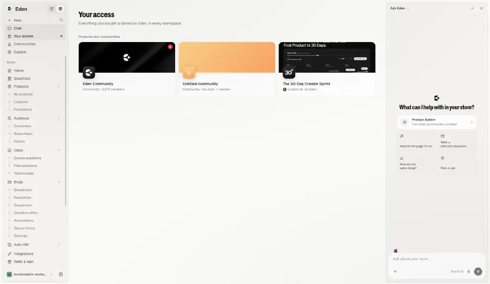 Eden reference (design we copy) — desktop</td>
<td>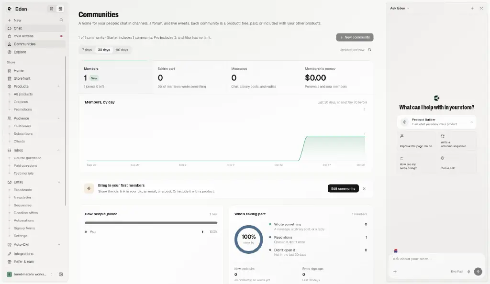 Eden reference (design we copy) — desktop</td>
</tr><tr>
<td>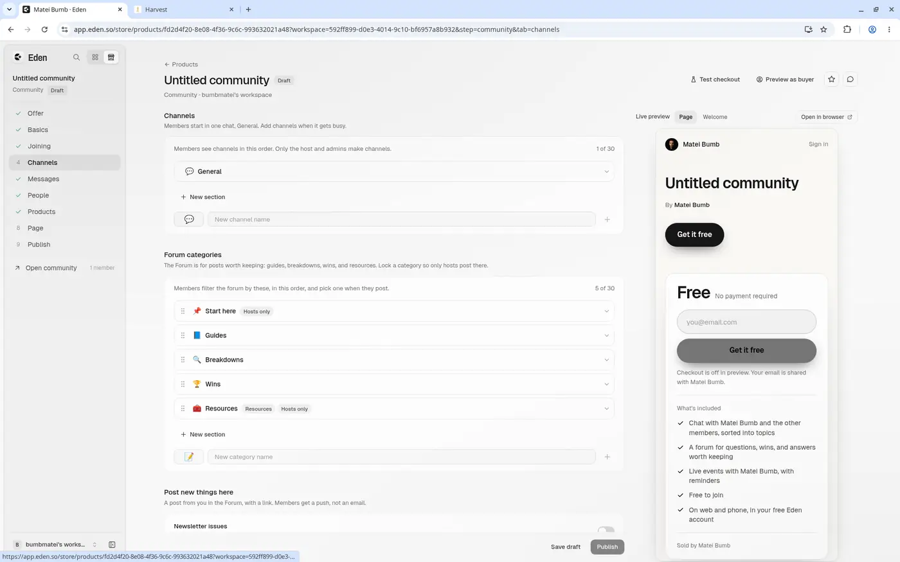 Eden reference (design we copy) — desktop</td>
<td>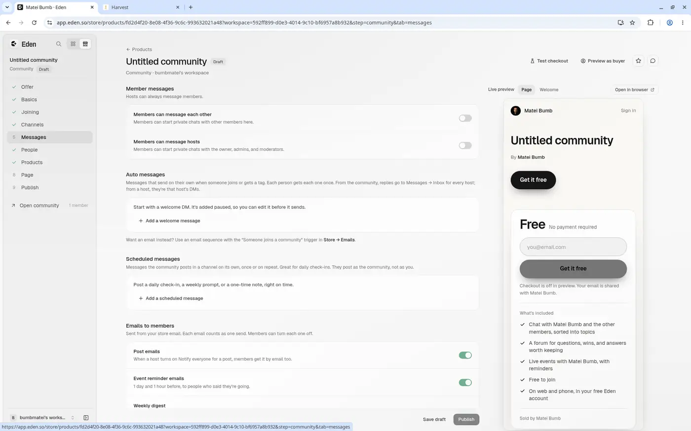 Eden reference (design we copy) — desktop</td>
</tr></table>

All 95 Eden reference screens for Communities and Discover are in
`docs/prd/screenshots/05-communities/` — see `_manifest.json` for the complete list (setup
wizard steps, feed, chat, member roster, Discover cards). All captured at desktop width; no
mobile Eden reference exists in the source archive for this surface.

### 5.12 Open questions
See [§21](#21-open-questions-for-matei) items tagged **Communities**.

---

## 6. Community join & CRM

### 6.1 Goal
Every join and every leave, across every community an owner runs, lands in **one CRM** —
never a separate list per community — with honest, server-enforced consent and an erasure path
that actually deletes data rather than just hiding it.

### 6.2 Users / roles
Owner (sees and can email the full CRM; alone can erase a contact's data), admin with CRM
permission (can see contacts; cannot erase another admin's contact — see
[§6.6](#66-erasure--consent)), member (joins/leaves; can request their own erasure).

### 6.3 Join creates a contact automatically
`POST /api/community/join` and the server-side `upsertCommunityContact`
(`src/lib/community-contact.ts`) run in the same transaction as the membership write. On a
genuine join (consent given, membership record valid), the server:
1. Looks for an existing contact linked to this `uid`, or an existing contact whose **verified**
   email matches (never an unverified claim) — so a returning member is recognised rather than
   duplicated, and a contact with gifts/notes/history already on it is never overwritten.
2. If none exists, creates `contacts/community_{tenantId}_{sha256(uid)}` with the member's name,
   email, the tenant, and the join **source** tag.
3. Never fabricates consent on retries: if the membership record itself has no `consentAt`, the
   contact upsert is skipped rather than invented.

### 6.4 One CRM, many communities — and the filters it needs
**Already true:** a ministry's CRM is one `contacts` collection scoped by `tenantId`
(`adminDb.collection('contacts').where('tenantId', '==', tenantId)`), and every community a
tenant runs — default or additional — writes into that same collection. There is no
per-community CRM to begin with; the "one CRM" requirement is already the shape of the data.

**Not yet true — the filter UI:** today's CRM filter (`CrmFilters` /
`matchesCrmFilters`, `src/lib/crm-filter.ts`) supports exactly three dimensions: free-text
search, contact `type` (`member`/`donor`/`both`), and newsletter opt-in status. It does **not**
expose filtering by:
- **Community** — which of the tenant's communities (default or additional) the contact's
  membership belongs to.
- **Source tag** — `normaliseSource()` already tags how a contact arrived (join path, which
  form, etc.), but the filter has no dimension for it.
- **Status Active/Left** — `communityStatus` already exists on the contact record (set to
  `'left'` on departure by `writeCommunityDeparture`) but isn't filterable in the CRM UI.
- **Event tags** — the `event:<eventId>` tag described in [§8](#8-events--communities-integration)
  needs a corresponding filter once that tagging ships.
- **Dates** — joined/left date range.

This is a **required enhancement**, not a rebuild: `CrmFilterable`/`CrmFilters` already has room
to grow, and the underlying fields (`source`, `communityStatus`, membership dates) already exist
on the contact record — the work is adding filter controls and extending
`matchesCrmFilters`/the CSV export together so the UI and the export can never disagree, which
is exactly the discipline the current file's own docblock describes.

### 6.5 Consent notice
**Required, and already partly real:** every join requires `consent: true` and the current
`COMMUNITY_CONSENT_VERSION` (`= 2`) to be accepted, or the server rejects it
(`communityMembershipRequest`, `src/lib/community-membership-api.ts`) — this part is a genuine
server-side gate, not decoration.

**Not yet built:** the brief requires the consent notice to **say plainly that the owner can
contact members and see their name, email and answers.** The member-facing join call today
(`CommunityMemberPage.tsx:67`) passes `consent: true` unconditionally — there is no plain-
language notice shown to the member before that call fires today showing what the owner can
see. The version-gating machinery to force re-consent when the wording changes already exists
(`acceptedConsentVersion`); what's missing is the actual notice text and its UI, which this PRD
does not invent copy for — see Open Questions for the exact wording to confirm with Matei.

### 6.6 Erasure & consent
- **Leave ≠ erase.** Leaving (`POST /api/community/leave`) keeps the contact, marks it
  `communityStatus: 'left'` with a `communityLeftAt` date, unsubscribes it from owner email
  (`emailStatus: 'unsubscribed'`), and removes the member from any chat channel they were in. The
  owner is blocked from emailing them from this point — see [§6.7](#67-email-block--rejoin).
- **Erasure is owner-only, or the member themself.** `POST /api/community/delete-data`
  (`src/app/api/community/delete-data/route.ts`) checks `tenant.ownerId === actor.uid` for
  anyone erasing someone else's data; a non-owner admin gets `403`. The brief's "delete button
  hidden from other admins" is the UI expression of this same server-side check — the UI must
  not merely hide the button cosmetically, since the API already refuses the request regardless.
  Erasure deletes the linked contact(s) and their `contactActivities`, replaces the membership
  record with a `dataDeletedAt` tombstone (so a future rejoin cannot be mistaken for a return to
  a still-live record), and deletes the member's own `memberships/{tenantId}` index entry. It
  never deletes Auth, the member's profile, another ministry's records, or financial records.

### 6.7 Email block & rejoin
- Leaving writes a **hashed-email suppression record** (`emailSuppressions/{sha256(email)}`,
  `communitySuppressionId` — SHA-256 today, with the brief noting HMAC as a future upgrade) that
  blocks owner email to that address, independent of any one contact record.
- **Rejoin clears the block, but only the rejoining user's own verified address, and only
  their own linked contacts.** `readCommunityRejoin`/`writeCommunityRejoin`
  (`src/lib/community-privacy.ts`) deliberately filter to `contact.data().communityUserId ===
  uid` — a contact's email field is admin-editable CRM data, so matching on email alone would
  let a rejoining member clear a *stranger's* opt-out simply because an admin had pointed a
  contact at that stranger's address. The block is cleared only when the stored block's `from`
  is `'community-leave'` (i.e., not a block from some other, unrelated opt-out) and the
  rejoining email is the token's own **verified** email — an unverified or forged email on the
  token clears nothing.
- `tenantEmailBlocked` / `tenantBlockedEmailHashes` are the single source of truth every
  owner-directed send (individual or bulk) must consult; a legacy plaintext `email` field on an
  old suppression record is scrubbed to a hash on first read (`scrubSuppressionEmail`), never
  left sitting in plaintext.

### 6.8 Eden parity
Eden's Customers/Clients surfaces (tags, import, add-one, active tab) are the closest analogue;
Harvest's CRM already looks and behaves like a CRM in its own right (donor pipeline stages,
type segmentation) beyond what Eden's version does, since giving is core to a ministry in a way
it isn't to a creator.

### 6.9 Data model notes
- `contacts/{id}`: `tenantId`, `type`, `email`, `communityUserId`, `communityStatus`,
  `communityLeftAt`, `source`, `emailStatus`.
- `tenants/{t}/emailSuppressions/{sha256(email)}`: `{ emailHash, status, at, from }`.
- `users/{uid}/memberships/{tenantId}`: deleted entirely on erasure (not just marked).
- `contactActivities/{id}`: `contactId`, `tenantId`, deleted alongside an erased contact.

### 6.10 Edge cases
- Two contacts could plausibly match the same verified email across retries — the join flow
  resolves this deterministically (linked-by-uid first, then lexically-first email match) so a
  retried request never creates a duplicate.
- A rejoin after erasure (`dataDeletedAt` set) must not resurrect the deleted contact; it should
  behave as a fresh join.
- An admin without `manageCommunity`/owner rights calling the erasure API directly (bypassing
  the hidden button) must still get `403` — the UI hiding the control is not the security
  boundary.

### 6.11 Mobile
CRM is predominantly an admin/desktop surface but must remain usable at mobile widths for an
owner checking a new lead between other tasks.

### 6.12 Acceptance criteria
- Joining any community a tenant runs produces exactly one CRM contact, tagged with the correct
  source and community.
- Leaving blocks owner email to that address immediately, and the block survives until a
  verified rejoin from that same address clears it.
- An admin who is not the owner cannot erase another contact's data via the API, regardless of
  what the UI shows them.
- The CRM filter set is extended to cover community, source tag, status, event tags and dates
  without changing what `matchesCrmFilters` and the CSV export each report for a given contact.

### 6.13 Screenshots

<table><tr>
<td>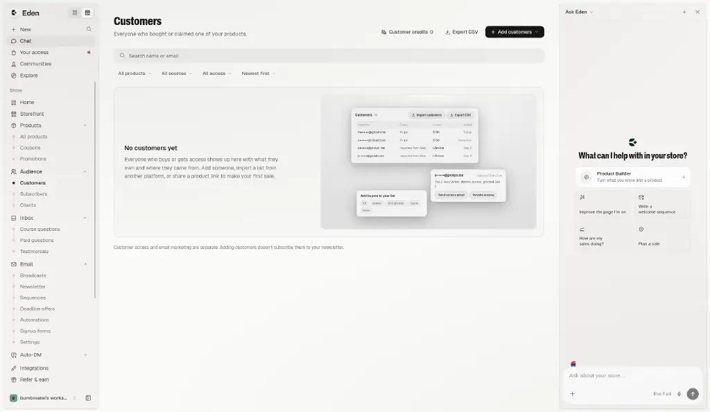 Eden reference (design we copy) — desktop</td>
<td>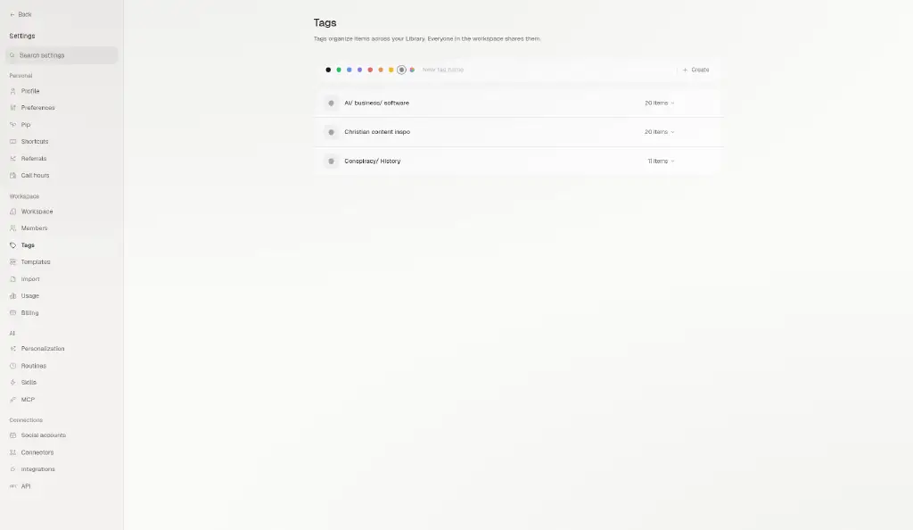 Eden reference (design we copy) — desktop</td>
</tr><tr>
<td>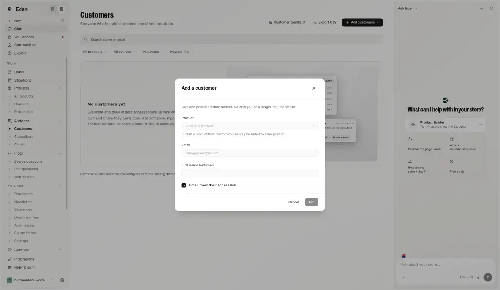 Eden reference (design we copy) — desktop</td>
<td>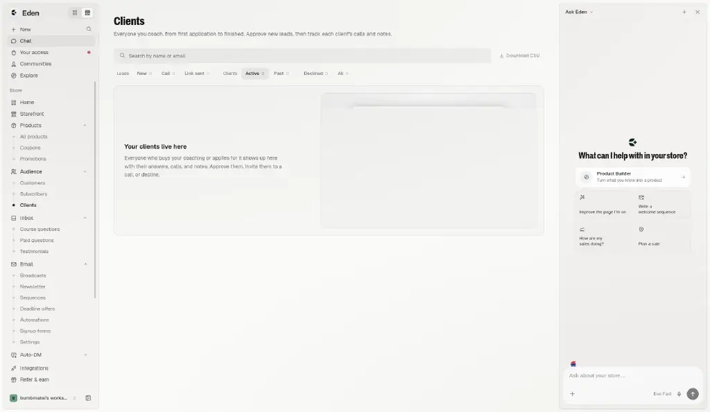 Eden reference (design we copy) — desktop</td>
</tr></table>

All 9 Eden reference screens for CRM/people/audience are in `docs/prd/screenshots/06-crm/`
(see `_manifest.json`) — customers list, tags, import, add-contact dialog, and the
active/leads tab pattern this section's Active/Left filter should mirror.

### 6.14 Open questions
See [§21](#21-open-questions-for-matei) items tagged **CRM**.

---

## 7. Events

### 7.1 Goal
An Eden-style events product: one-time or recurring events, public registration (including a
Luma-style public page), optional paid tickets, and an honest cancellation path — all without
Harvest ever touching a card itself (see the money model in `AGENTS.md`).

### 7.2 Users / roles
Owner/admin (creates/edits/cancels events, confirms manual payments), registrant/member
(registers, receives a ticket), visitor (views and registers from the public event page without
an account, where allowed).

### 7.3 Functional requirements, grounded in code
- **Recurrence:** events carry a `recurrence` rule (`freq`, an end mode of never/on-date/after-N,
  and a `cancelledRuns` list for one-off cancellations within a series) expanded into concrete
  **runs** by `expandRuns`/`listEventRuns` (`src/lib/events/recurrence.ts`,
  `src/components/AdminEvents.tsx`). A recurring event's schedule can be locked once runs exist,
  to stop an edit from silently reshaping dates registrants already hold tickets for.
- **Public registration page:** a Luma-style public page per event, registering **one person at
  a time** per the shipped feature (`AGENTS.md` commit history: "Luma public page, one-at-a-time
  registration"), with a registration cutoff shared between the initial submit and payment
  completion (`src/lib/events/registration-cutoff.ts`) so a deadline can't be bypassed by
  completing payment after it passes.
- **Paid tickets run on trust, not on Harvest processing a card** (`AGENTS.md`'s money model,
  `PAID_EVENTS_ENABLED = false`, `MANUAL_EVENT_PAYMENTS_ENABLED = true`): register unpaid → pay
  the ministry directly using a reference code → tell Harvest "I've paid" → the ministry
  confirms from its own account records. **The QR/ticket code is withheld until that
  confirmation lands** (`UserEvents.tsx` — `paymentStateOf`, ticket view gated on `payment ===
  'confirmed'`); a free ticket's QR shows immediately, since there's nothing to confirm.
- **Cancelling an event, or a single date in a series, automatically emails every affected
  registrant.** `cancelEventRegistrations` (`src/lib/events/cancellation.ts`) is fully built:
  it marks the event/run cancelled transactionally, writes one
  `eventCancellationNotices/{registrationId}` record per affected registrant *before* sending
  (so a retry after a partial failure never double-sends and never loses track of who's left),
  and sends via `sendTransactionalEmail` (Resend) with copy that explicitly says **"Contact the
  event owner/organizer about any refund. Refunds are handled manually by the ministry; Harvest
  does not issue an automatic refund."** A paid registration is flagged `refundStatus:
  'pending_manual'` on cancellation — refunds themselves (e.g. via PayPal) are the ministry's
  own action, with automatic refunds explicitly a later phase, not this one.
  `CANCELLATION_EMAIL_BATCH_SIZE = 20` bounds each send pass; the function is safely retryable
  and refuses to resend past Resend's 24-hour idempotency-key retention window without a human
  reviewing delivery first.
- **Check-in never blocks on payment** (`AGENTS.md`) — Harvest makes no promise about what
  happens at the ministry's actual door, because it doesn't know their door policy.

### 7.4 Eden parity
The reference set covers Eden's event creation dialog, the schedule-for-later flow, the
past/upcoming tabs, and the member-facing event detail page (including its questions section) —
Harvest's admin event editor and public event page should match this shape and density.

### 7.5 Plan availability
Events are available on every plan; manual-payment ticketing is a capability, not a plan gate,
per the money model (Harvest never touches the money either way).

### 7.6 Data model notes
`tenants/{t}/events/{id}`: `recurrence`, `startDate`, `endDate`, `timeZone`, `organizerEmail`,
`status`. `tenants/{t}/registrations/{id}`: `eventId`, `runDate`, `status`
(`confirmed`/`waitlisted`/`cancelled`), `cancellationReason`, `refundStatus`, `ticketCode`.
`tenants/{t}/eventCancellationNotices/{registrationId}`: the frozen, idempotent notice payload.

### 7.7 Edge cases
- A registration created *after* cancellation starts but *before* the transaction commits must
  still be read and notified — `cancelEventRegistrations` deliberately re-reads registrations
  after the cancellation gate closes rather than working off a pre-gate snapshot.
- A cancellation retry after some notices already sent must not re-email anyone whose notice
  already has a `sentAt`.
- An event with no resolvable organizer contact (no `organizerEmail`, no creator, no tenant
  owner email) must refuse to cancel with notices unsent rather than cancel silently with nobody
  told.

### 7.8 Mobile
Public registration and the member's ticket/QR view are primarily mobile surfaces (a registrant
checking in at a door); the admin event editor must also work at mobile width for a volunteer
managing check-in from a phone.

### 7.9 Acceptance criteria
- Cancelling a single date in a recurring series notifies only that date's registrants, not the
  whole series.
- A paid ticket never shows its QR/ticket code before the ministry confirms payment; a free
  ticket shows it immediately.
- A registration submitted one second before a deadline and paid one second after it is rejected
  at payment completion, not only at initial submit.

### 7.10 Screenshots

<table><tr>
<td>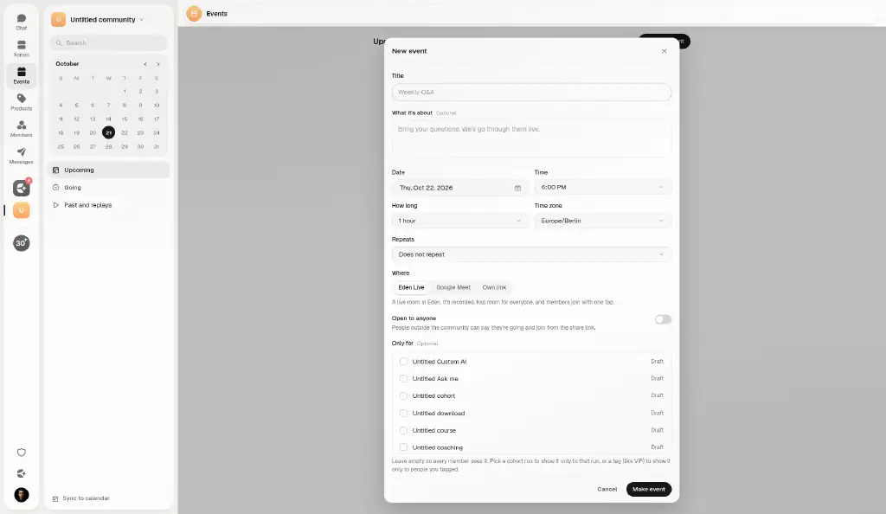 Eden reference (design we copy) — desktop</td>
<td>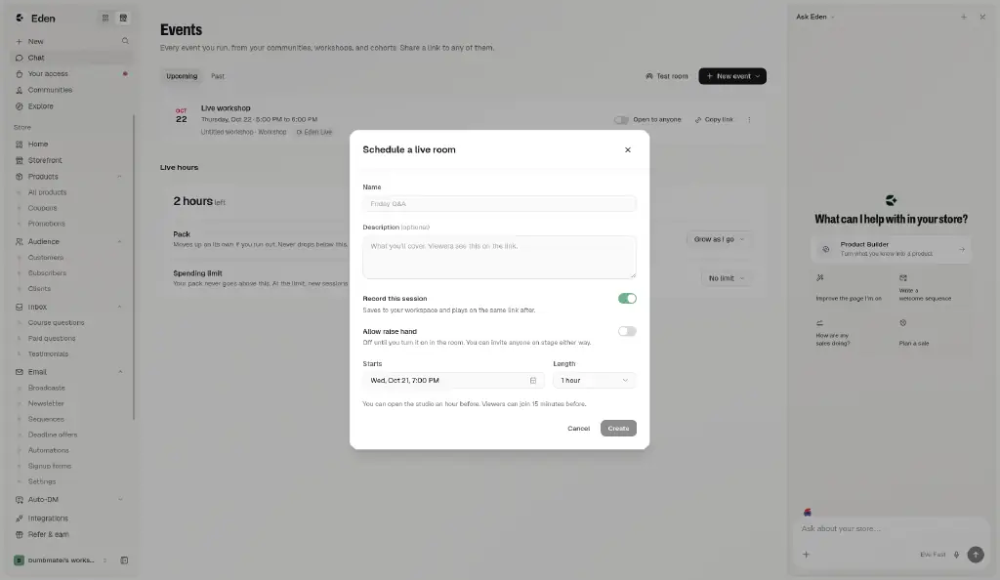 Eden reference (design we copy) — desktop</td>
</tr><tr>
<td>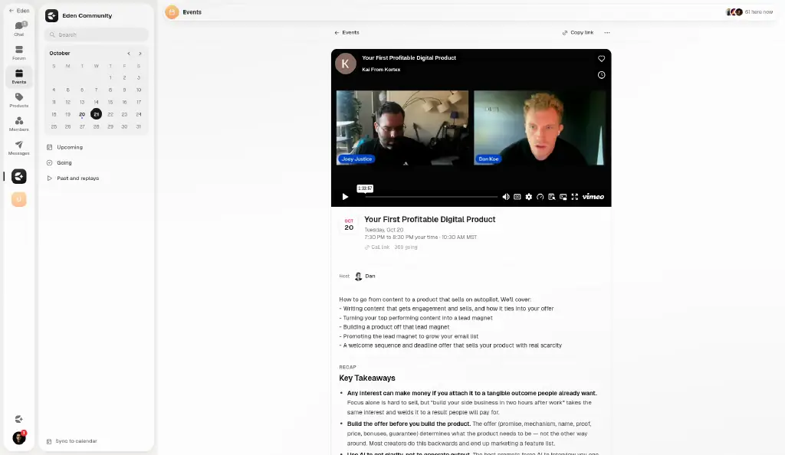 Eden reference (design we copy) — desktop</td>
<td>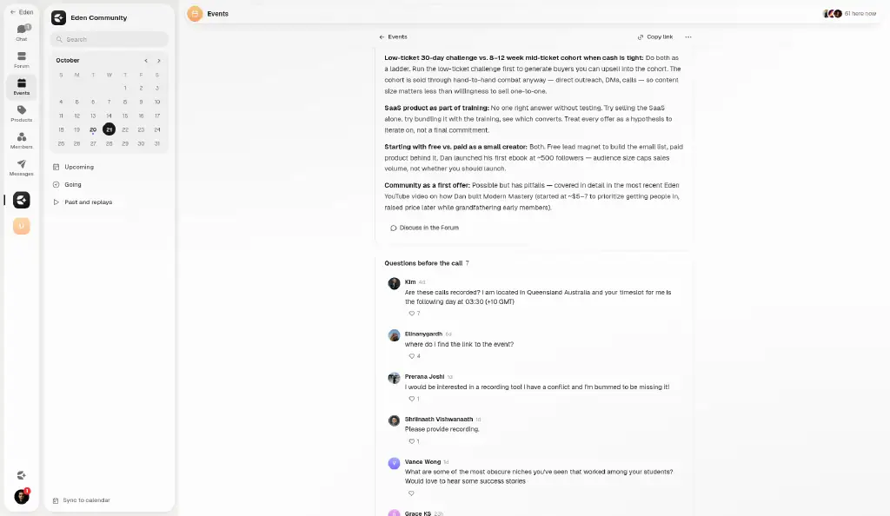 Eden reference (design we copy) — desktop</td>
</tr></table>

All 15 Eden reference screens for Events are in `docs/prd/screenshots/07-events/` (see
`_manifest.json`): the new-event dialog, schedule/recurrence pickers, past/upcoming tabs, and
the member-facing event detail page including its questions section.

### 7.11 Open questions
See [§21](#21-open-questions-for-matei) items tagged **Events**.

---

## 8. Events + Communities integration

### 8.1 Goal
Let an event belong to a specific community, so it's visible in that community's page, follows
that community's visibility, notifies that community's members (respecting email blocks), and —
optionally — registering for it also joins the community, with CRM tagged accordingly.

### 8.2 Status: not yet built
A direct code search finds **no `communityId` field on events, no "Registering also joins
&lt;community&gt;" toggle, and no `event:<eventId>` CRM tag anywhere in the codebase.** This
section is written as a concrete, buildable requirement on top of primitives that already
exist and already do the matching job elsewhere in the product — it is not a description of
shipped behaviour.

### 8.3 Functional requirements (proposed, to build)
- **An event can belong to a community.** Add an optional `communityId` to the event record,
  validated server-side against the **same tenant's** `communities` sub-collection (or the
  default community) — exactly the "same tenant, server-checked" pattern already used for
  community membership itself ([§5](#5-communities), [§6](#6-community-join--crm)). A
  cross-tenant `communityId` must be rejected the same way a cross-tenant join is rejected today.
- **Listed in the community page's Events section.** The community's member-facing page gains an
  Events section listing events whose `communityId` matches, ordered the same way
  `AdminEvents.tsx` already orders runs.
- **Visibility follows the community.** A private community's events are visible only to its
  members; a public community's events appear to visitors the way the community's own About
  page does today.
- **Members notified, respecting email blocks.** Any event-related email to community members
  (new event announced, reminder, cancellation per [§7.3](#73-functional-requirements-grounded-in-code))
  must be checked against `tenantEmailBlocked`/`tenantBlockedEmailHashes`
  (`src/lib/community-privacy.ts`) — the same single source of truth every other owner-directed
  send already goes through. This is a reuse requirement, not a new suppression mechanism.
- **"Registering also joins &lt;community&gt;" toggle.** An owner setting on the event; when on,
  a successful registration also runs the **normal join path**
  (`communityMembershipRequest`/`upsertCommunityContact`) rather than a shortcut that writes
  membership directly — so the consent notice, the membership index, and the CRM contact upsert
  all happen exactly as they would for a direct join (see [§6.3](#63-join-creates-a-contact-automatically)).
  For a **paid** event, this must happen from the **webhook** (payment confirmation), not from
  the initial unpaid registration request, mirroring the money model's "register unpaid, confirm
  later" sequencing in [§7.3](#73-functional-requirements-grounded-in-code) — joining before
  payment is confirmed would let an unconfirmed registrant's name/email enter the CRM as if they
  had actually joined.
- **CRM tag `event:<eventId>`.** The contact created or updated by the join-on-register path
  carries a source/tag identifying which event drove the join, extending
  `normaliseSource()`/the CRM filter work already required in [§6.4](#64-one-crm-many-communities--and-the-filters-it-needs).
- **Consent notice shown.** Since joining-via-registration is the same join path as a direct
  join, the same consent notice requirement from [§6.5](#65-consent-notice) applies —
  registering for an event is not an exemption from consent.

### 8.4 Eden parity
Eden has no direct analogue (events are not scoped to a specific community sub-product in the
reference material); this integration is Harvest-specific, built from the Events and
Communities primitives above rather than copied from an Eden screen.

### 8.5 Data model notes
- `tenants/{t}/events/{id}.communityId?`: optional, validated against `tenants/{t}/communities`
  or the default community.
- `tenants/{t}/events/{id}.joinsCommunity?`: boolean, the "Registering also joins" toggle.
- Contact `source`/tag: extend to carry `event:<eventId>` alongside the existing community
  source tag.

### 8.6 Edge cases
- An event whose community is later deleted: the event should not silently lose its visibility
  rule — deleting a community with events attached needs an explicit decision (orphan the event
  to "no community," or block deletion while events reference it).
- A paid event with the join toggle on, where the registrant's payment is never confirmed: no
  join, no CRM contact from this path — the webhook never fires, so nothing is created.
- A community that goes private after an event was already public: already-registered members
  keep their registration; new registrants follow the community's current visibility.

### 8.7 Mobile
Same as [§5.9](#59-mobile) and [§7.8](#78-mobile) — the community page's Events section and the
registration-with-join flow are both primarily mobile surfaces.

### 8.8 Acceptance criteria
- An event's `communityId` can only reference a community in the same tenant; cross-tenant
  references are rejected server-side, not just hidden in the UI.
- A member blocked (left and not rejoined) never receives an event notification tied to that
  community, even if they are somehow still registered for the event itself.
- Registering for a paid event with the join toggle on creates the CRM contact and membership
  only after the payment webhook confirms, never on the initial unpaid submission.

### 8.9 Screenshots
No dedicated Eden reference exists for this Harvest-specific integration; see
[§7.10](#710-screenshots) and [§5.11](#511-screenshots) for the Events and Communities screens
this feature connects.

### 8.10 Open questions
See [§21](#21-open-questions-for-matei) items tagged **Events-Communities**.

---

## 9. Forms & Sign-ups

### 9.1 Goal
Copy Eden's forms/sign-up-page product closely enough to inherit its builder, submissions
view and KPIs, while adding the two things Harvest's evangelism loop depends on everywhere
else in this document: a QR code on every form and sign-up page, and an after-submit invitation
into a community or product.

### 9.2 Users / roles
Owner/admin (builds forms and sign-up pages, reads submissions/inbox), visitor (fills the
public form, no account needed), member (the same visitor, once they act on the after-submit
card).

### 9.3 What exists today
Harvest actually ships **two** related but separate surfaces, and the brief's requirements land
differently on each:
- **Forms** (`AdminForms.tsx`): builder with field types, a submissions count per form
  (`submissionCount`), and a "Share" panel with **Copy Link** and **Embed Code** — reusable as an
  iframe. It has no QR code today.
- **Sign-up pages** (`src/components/signup-pages/`: `SignupPageBuilder.tsx`,
  `PublicSignupForm.tsx`, `SubmissionsTable.tsx`, `ShareCard.tsx`): a separate builder with its
  own public page at a handle, a submissions table, and — unlike Forms — a working QR code
  already: `ShareCard.tsx` generates one via `QRCode.toDataURL` and offers **Download PNG**.

### 9.4 After-submit card
**Required, not yet built on either surface.** A direct search for `afterSubmit` (and
equivalent names) across the codebase returns nothing — there is no config today for "after
submit, show a community or product as a Discover-style card with Join/View." This is the
mechanism the whole evangelism loop in [§1.2](#12-the-evangelism-loop-this-product-is-built-around)
depends on, so it needs building, not polishing: an owner picks a community or a product when
building the form/sign-up page; on successful submit, the public page renders the same
Discover-card component used on the Discover page itself ([§5.4](#54-functional-requirements))
with Join/View, so a visitor who just handed over their name and email sees the invitation to go
further in the same motion.

### 9.5 QR codes — required on every plan, PNG + SVG
- **What exists:** Sign-up pages already generate and download a PNG QR via the `qrcode`
  package. Events also generate a registration QR (`AdminEvents.tsx`) the same way. Forms have
  none.
- **What's required and missing everywhere:** (a) Forms need the same QR capability Sign-up
  pages already have; (b) every QR download — Forms and Sign-up pages alike — needs an **SVG**
  option alongside PNG. The `qrcode` package already supports an SVG string output
  (`QRCode.toString(url, { type: 'svg' })`); nothing in the codebase calls it today — every
  existing QR consumer (`AdminQR.tsx`, `ShareCard.tsx`, `AdminEvents.tsx`) only calls
  `toDataURL` for a PNG data URL. Centralizing this (one shared QR-download helper offering both
  formats) avoids a fourth inlined copy of the same PNG-only pattern.
- QR codes are on **every plan including Free** — this is already true in spirit since nothing
  in the existing QR code paths checks a plan feature flag; it should stay that way explicitly
  as the feature is extended.
- Every link encoded is a `theharvest.app` path (`formUrl(editingId)`, the sign-up page's
  handle-based URL) — no subdomain involved, consistent with [§2](#2-accounts--tenancy).

### 9.6 Inbox / KPIs
Sign-up pages already have a `SubmissionsTable`; Forms track `submissionCount` per form. An
"inbox" view across both (per the brief's mention of an inbox) does not yet exist as a unified
surface — see Open Questions for whether this should be one inbox across Forms + Sign-up pages
or stay split by surface.

### 9.7 Eden parity
The reference set covers Eden's own Inbox (paid questions, testimonials), its marketing
forms/quizzes list, the form editor's build/settings/responses tabs, the template picker, and
its embeddable email sign-up form editor (content/look/settings tabs, "get code" dialog) —
Harvest's Forms and Sign-up pages builders should converge toward this single shape rather than
stay two visually distinct products.

### 9.8 Plan availability
Forms, Sign-ups, and their QR codes are available on **Free**, per [§3.5](#35-free-plan-shell).

### 9.9 Data model notes
`forms/{id}`: fields, `submissionCount`, `afterSubmit?` (proposed: `{ kind: 'community' |
'product', targetId }`). `signupPages/{handle}`: similar shape plus the existing public handle
routing. Submissions: one doc per submission, linked to the form/page id.

### 9.10 Edge cases
- A form/sign-up page whose configured after-submit community or product is later deleted must
  fail safe (no card shown, not a broken link) rather than 404 the whole success state.
- A QR code must keep working even if the underlying form is later renamed — it should encode
  the stable id/handle, not anything that changes with a rename.

### 9.11 Mobile
The public form and the after-submit card are overwhelmingly mobile surfaces — the entire point
of the QR-code loop is "scanned on a phone, filled in on a phone."

### 9.12 Acceptance criteria
- Every form and every sign-up page has a QR code downloadable as both PNG and SVG, on every
  plan.
- Configuring "after submit, show a community" on a form results in the submitter seeing a
  Discover-style Join/View card immediately after submitting, with no extra step.
- Submitting a form/sign-up page that is configured to show a community after submit also
  behaves consistently with the join path in [§6.3](#63-join-creates-a-contact-automatically) if
  the visitor acts on it — it is an invitation, not an automatic join.

### 9.13 Screenshots

<table><tr>
<td>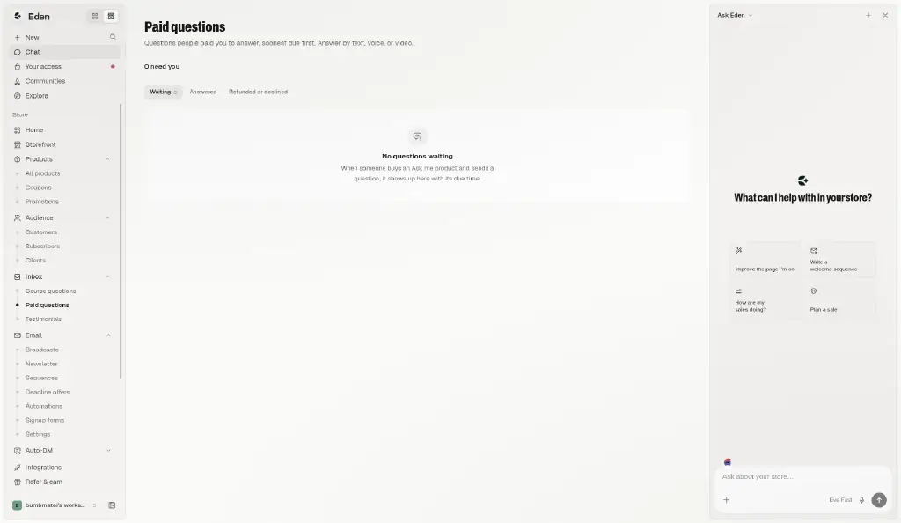 Eden reference (design we copy) — desktop</td>
<td>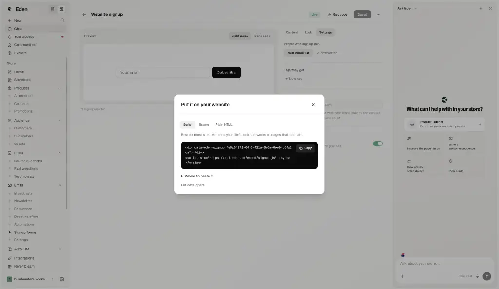 Eden reference (design we copy) — desktop</td>
</tr><tr>
<td>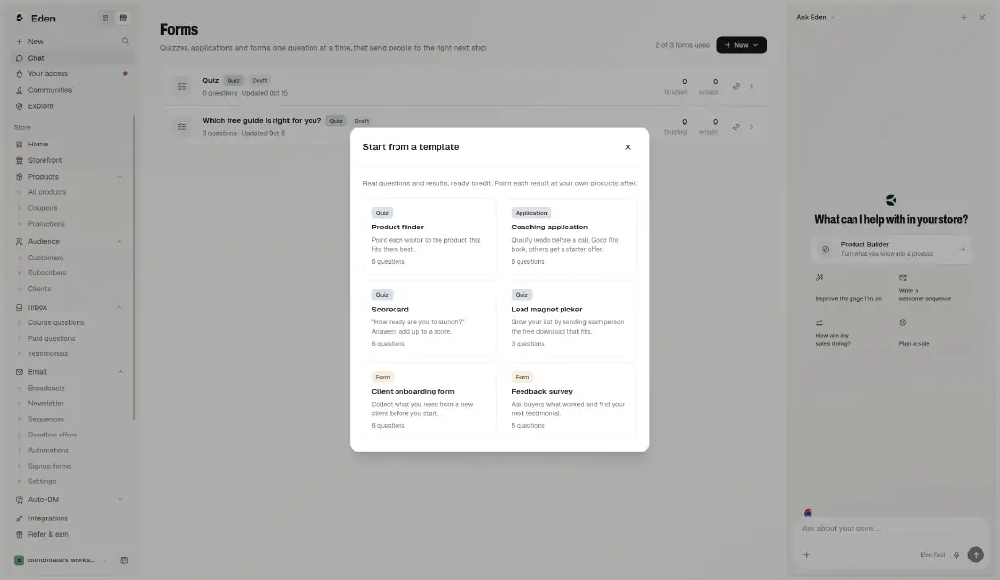 Eden reference (design we copy) — desktop</td>
<td>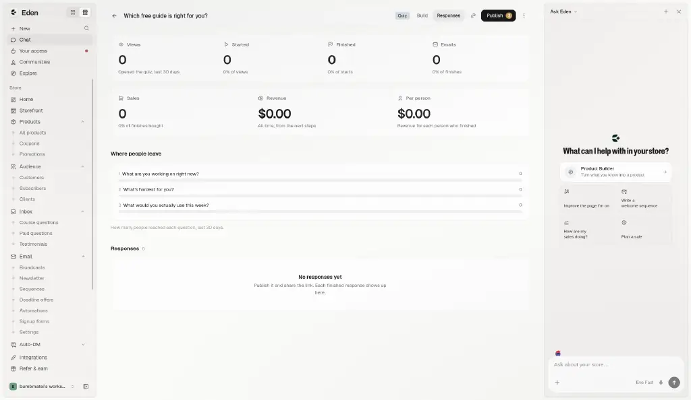 Eden reference (design we copy) — desktop</td>
</tr></table>

All 20 Eden reference screens for Forms, Sign-ups and Inbox are in
`docs/prd/screenshots/09-forms-signups/` (see `_manifest.json`).

### 9.14 Open questions
See [§21](#21-open-questions-for-matei) items tagged **Forms**.

---

## 10. Products

### 10.1 Goal
A single "New product" picker that can grow over time — digital products, courses,
memberships, coaching, calendar/booking — all sharing one product-page and checkout pattern,
following Eden's own product range closely but shipping only what a ministry actually needs
first.

### 10.2 Users / roles
Owner/admin (creates/publishes products), member/buyer (views the product page, enrolls or
downloads), visitor (sees the public product page before deciding to join/buy).

### 10.3 What's actually built today, grounded in code
`src/components/product-wizard/product-types.tsx` is the single source of truth for this, and
it is refreshingly explicit about its own roadmap:

> "Course and Digital download have builders today. The rest are listed so the roadmap is
> visible and cannot be picked."

| Product type | `available` | Status |
|---|---|---|
| **Course** | `true` | Built — lessons in order, with progress and a certificate. |
| **Digital download / Ebook** | `true` | Built — `src/app/api/digital-products/*`: upload, claim, download, entitlement-gated. |
| **Coaching** | `false` | Listed only — "One-to-one or small-group sessions you book with people." No booking/calendar code exists for it. |
| **Bundle** | `false` | Listed only. |
| **Community (as a product)** | `false` | Listed only — distinct from the Communities feature in [§5](#5-communities), which already exists; this entry is about offering a community *as a purchasable product* in this picker, not built. |
| **"More coming soon"** | `false` | A placeholder card, not a real type. |

So: **Coaching, calls & calendar booking, and the "other Eden product types" (cohort, workshop,
Ask-me, Custom AI) are reference-only in this document** — the 50 screenshots under those two
areas show what Eden offers, not what Harvest has built or is committed to building next. They
are included for completeness per this document's instructions, not as a roadmap commitment.

### 10.4 Courses
- A course's fields (`CourseProductFields`, `src/types/course-product.types.ts`) are additive
  over the shared `Course` type so a document written before this model still parses.
- **Access control:** `accessMode` is `'everyone'` (legacy default) or `'restricted'`, with an
  explicit `accessUserIds` allow-list, **and/or `communityIds`** — "members of any of them get
  access." This is a real, already-built tie between Products and Communities: a course can be
  gated by community membership today, which is worth noting precisely because
  [§8](#8-events--communities-integration) proposes the equivalent for Events and is *not* built
  yet.
- **Pricing is parked, not live:** `CoursePrice.mode` is `free`, `one-time`, or `membership`, but
  the type's own docblock says it plainly — "Nothing here is ever charged: paid checkout is
  parked, so a price is a stored intention and no payment call reads it." This matches
  `PAID_PRODUCT_CHECKOUT_ENABLED = false` in `AGENTS.md`: every surface that shows a course price
  today is showing an intention, and must say "coming soon," never imply a working checkout.
- Lessons are `text`, `video`, or `video-text` (`LessonType`), with a certificate on completion
  referenced elsewhere in the course UI.

### 10.5 Digital products / downloads
Upload → stored on R2 (`createR2Client`) → entitlement-gated download/claim
(`hasDigitalEntitlement`, `src/lib/digital-products.ts`). Validated server-side: title, cover
URL, `priceCents` (a non-negative integer — cents, per `AGENTS.md`'s money-unit rule), status
(`draft`/`published`). The admin route also supports a tenant-scoped admin view gated by the
`createCourses` permission.

### 10.6 Coupons, promotions & checkout
No coupon/promo-code feature exists in the codebase today (no route, no field, no UI). This
tracks directly with product checkout itself being "coming soon" per the money model — a coupon
on a checkout that doesn't process payment yet has nothing to attach to. Treat this as a
future-phase item once `PAID_PRODUCT_CHECKOUT_ENABLED` actually flips.

### 10.7 Shared editor layout
Per `AGENTS.md`'s design-system note, every product editor — courses, digital downloads, and
any future type — uses the same three-panel layout as the Communities editor
([§5.4](#54-functional-requirements)): steps on the left, options in the middle, live preview on
the right. A new product type's editor should reuse this, not invent its own.

### 10.8 Eden parity
This section carries the largest reference set in the document (128 screens) because it spans
Eden's Library/Notes/Boards system, its full Products hub and new-product picker, its Course
product builder and Inbox (course questions), its Coaching product builder end to end
(configure → offer → publish), and the "other product types" (cohort, workshop, Ask-me, Custom
AI) included for reference even though none of them are committed Harvest features.

### 10.9 Plan availability
Courses and digital downloads are available per plan caps (see `PLAN_FEATURES`); Free's
sign-up brief specifically allows "one adopted course" per `AGENTS.md`'s Free-tier description.

### 10.10 Data model notes
`courses/{id}`: `CourseProductFields` fields above, `communityIds`, `accessUserIds`.
`tenants/{t}/digitalProducts/{id}`: `title`, `description`, `coverUrl`, `priceCents`, `status`,
`objectKey` (R2).

### 10.11 Edge cases
- A course gated by `communityIds` whose referenced community is later deleted must fail safe
  (deny access, not crash) rather than treat a missing community as "everyone."
- A digital product's `priceCents` must never be trusted from the client on the download/claim
  path — entitlement is checked server-side regardless of what price the UI displayed.

### 10.12 Mobile
Course lesson playback and the digital-download claim/download flow are primarily mobile
surfaces for members; the product editor (admin) must also be usable at mobile width.

### 10.13 Acceptance criteria
- A course with `communityIds` set grants access to a member of *any* listed community, and
  denies access otherwise, enforced server-side.
- No UI anywhere claims a working checkout for a course or digital product's paid price while
  `PAID_PRODUCT_CHECKOUT_ENABLED` is false — the copy must say "coming soon."
- The "New product" picker never lets a visitor select `available: false` types; they render
  informationally only.

### 10.14 Screenshots

<table><tr>
<td>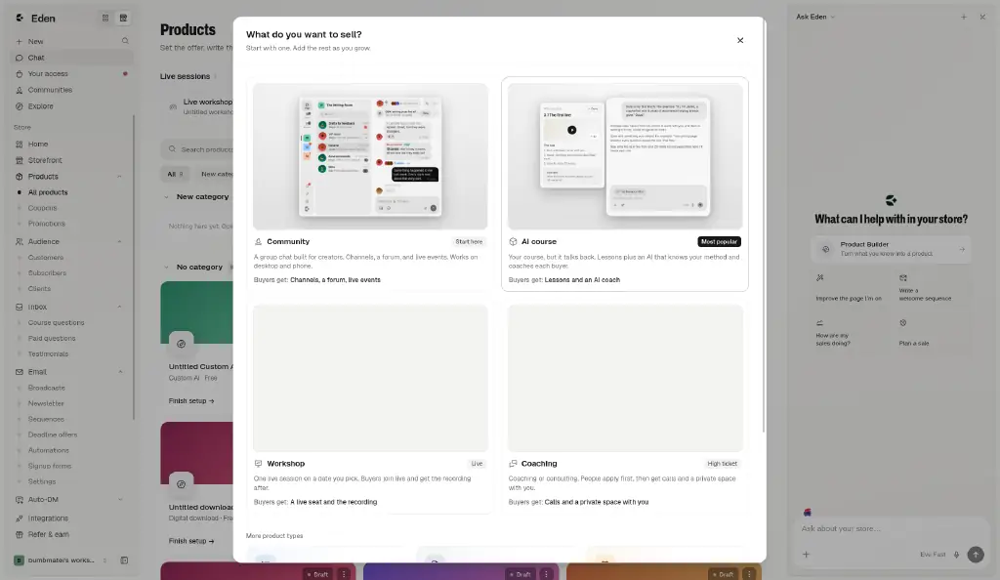 Eden reference (design we copy) — desktop</td>
<td>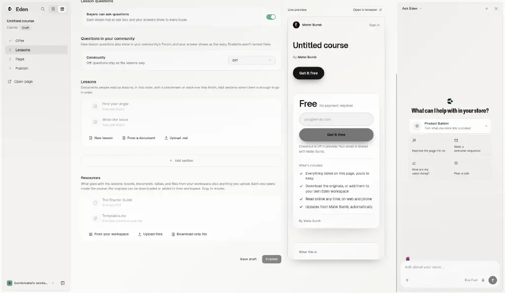 Eden reference (design we copy) — desktop</td>
</tr><tr>
<td>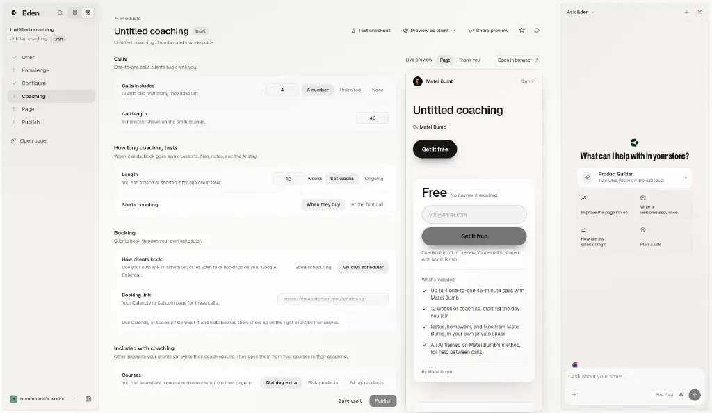 Eden reference (design we copy) — desktop (reference only — not a built feature)</td>
<td>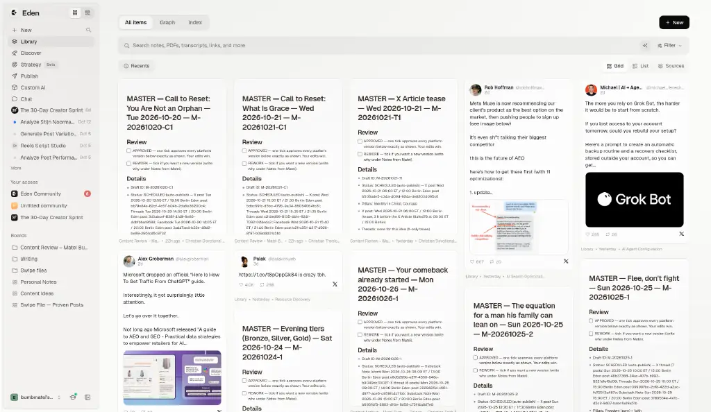 Eden reference (design we copy) — desktop</td>
</tr></table>

All 128 Eden reference screens for Products, Courses, Digital products, Notes/Boards/Library,
Coaching/calendar booking, the other Eden product types, and Coupons/checkout are in
`docs/prd/screenshots/10-products/` (see `_manifest.json` for the complete list and which area
each came from).

### 10.15 Open questions
See [§21](#21-open-questions-for-matei) items tagged **Products**.

---

## 11. Link in bio

### 11.1 Goal
Carry over Eden's link-in-bio/storefront design vocabulary — profile header, social row,
tabbed/categorised content, blocks, themes — as the visual and structural language for
Harvest's ministry-facing public page, per Matei's explicit direction.

### 11.2 Status: merged into the website builder, not a separate product
No standalone "link in bio" component, route, or builder exists in the codebase, and per the
decided direction in `website-brief.md` (Matei, 2026-10-28 04:10–04:46): **"public page layout =
link-in-bio with tabs"** — Harvest does not ship a separate bio-link product the way Eden ships
Link-in-bio and Storefront as two things. Instead, the ministry's one public page
([§13](#13-website-builder--public-website)) **is** structured like Eden's link-in-bio page:
profile header (photo/logo, name, short info, social row, primary buttons), then shadcn `Tabs`
(About, Blog, Give, Events, Watch, Community, and any other enabled section), admin-ordered.
Eden's storefront editor (`eden-ref/12-link-in-bio-editor.png`, `13-link-in-bio-add-block.png`,
`eden-archive/02-store/84-storefront-editor-top.png`, 116–121) is the named primary reference
for both the public page structure *and* the admin editor's block/theme/add-section pattern.

### 11.3 What the brief asks this section to cover, mapped to where it actually lives
- **Tabs** → the public page's tab row, specified in [§13](#13-website-builder--public-website).
- **Blocks** → "Add section" in the website builder (hero, about, service times, location, give,
  contact, blog, events, watch-live, and the **Community card** block — see
  [§11.4](#114-the-community-card-block)).
- **Designs/themes/templates** → the website builder's 3 templates (Classic/Modern/Simple) and
  their accent/mode options.
- **Editor and public view, mobile** → specified in [§13](#13-website-builder--public-website)
  directly, including the Desktop/Mobile preview toggle.

### 11.4 The Community card block
A dedicated block kind, decided in the same brief (Matei, 2026-10-28 04:18): the admin picks one
or more of the ministry's own communities ([§5](#5-communities), read-only here) and the block
renders **the exact same Discover card component** used on the Discover page itself — cover,
logo, name, short description, member count, rating, "Free"/"coming soon" pricing, and a Join
button — never a lookalike rebuilt for this context. Hidden automatically if the referenced
community is private-and-unlisted or if Communities is off for the tenant. The join flow from
this card: a visitor without an account signs up for a free Harvest account, lands back on that
community's About/pre-join page, and joins from there; a logged-in visitor goes straight to the
join step.

### 11.5 Newsletter subscribe block
A "Subscribe to newsletter" button/block on the public page, wired to the **existing** Plunk-
backed newsletter feature ([§12](#12-newsletter)) — reusing its public subscribe endpoint and
subscriber collection, with the same consent/confirmation/unsubscribe behaviour as the
newsletter's own public subscribe page, not a second implementation. `SubscribeForm`
(`src/components/email/SubscribeBlock.tsx`) already exists and posts to
`/api/email/subscribe` — this is the component the website-page block should reuse, per the
brief's explicit instruction not to add a new email provider or a second subscribe form. The
button must hide itself if the newsletter is off for that tenant.

### 11.6 Branding footer
A small, non-intrusive "Made with Harvest" badge/link at the bottom of the public page — never
a popup, modelled on Skool's "Powered by Skool" treatment.

### 11.7 Eden parity
This section's 19 screenshots (Eden's storefront top/bottom, marketing links list, the
storefront editor's full scroll including themes/accent, and the link-in-bio editor's add-block
panel) are the direct design source for [§13](#13-website-builder--public-website)'s public page
and editor — treat them as that section's reference material.

### 11.8 Plan availability
Per [§13](#13-website-builder--public-website): website + subdomain are available on every plan
per the most recent direction (superseding an earlier draft that limited the public site to
paid plans) — see that section's own open question about which draft is final.

### 11.9 Data model notes
See [§13.6](#136-data-model-notes) — there is one website document per tenant, not a separate
link-in-bio document.

### 11.10 Edge cases
See [§13.8](#138-edge-cases).

### 11.11 Mobile
See [§13.7](#137-mobile).

### 11.12 Acceptance criteria
- No separate "link in bio" builder or route is built; the website builder in
  [§13](#13-website-builder--public-website) is the single implementation of this design
  language.
- The Community card block renders byte-for-byte the same Discover card component as
  [§5.4](#54-functional-requirements), not a reimplementation.
- The newsletter subscribe block on the public page creates a subscriber through the exact same
  path as the newsletter's own public subscribe page.

### 11.13 Screenshots

<table><tr>
<td>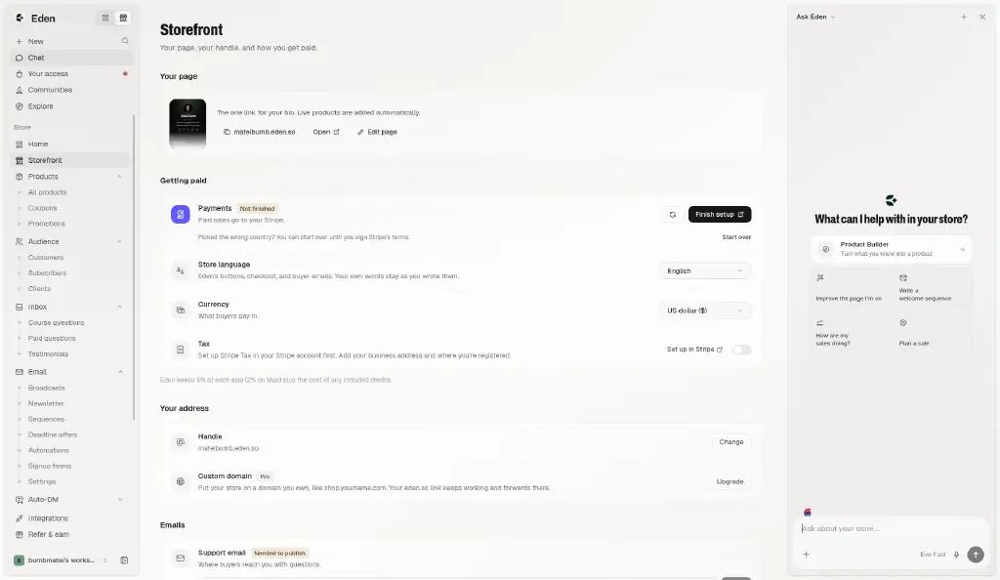 Eden reference (design we copy) — desktop</td>
<td>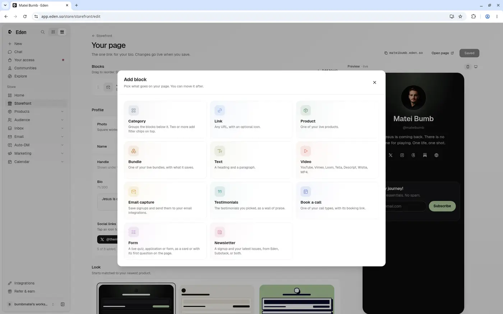 Eden reference (design we copy) — desktop</td>
</tr><tr>
<td>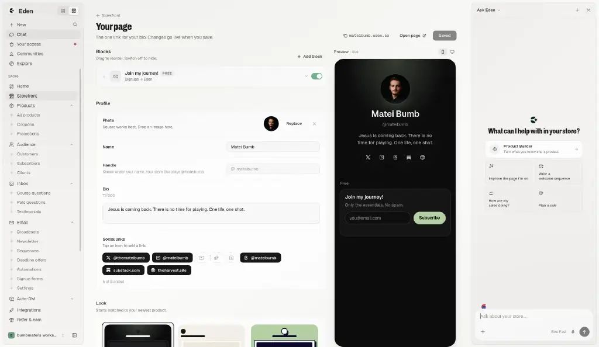 Eden reference (design we copy) — desktop</td>
<td>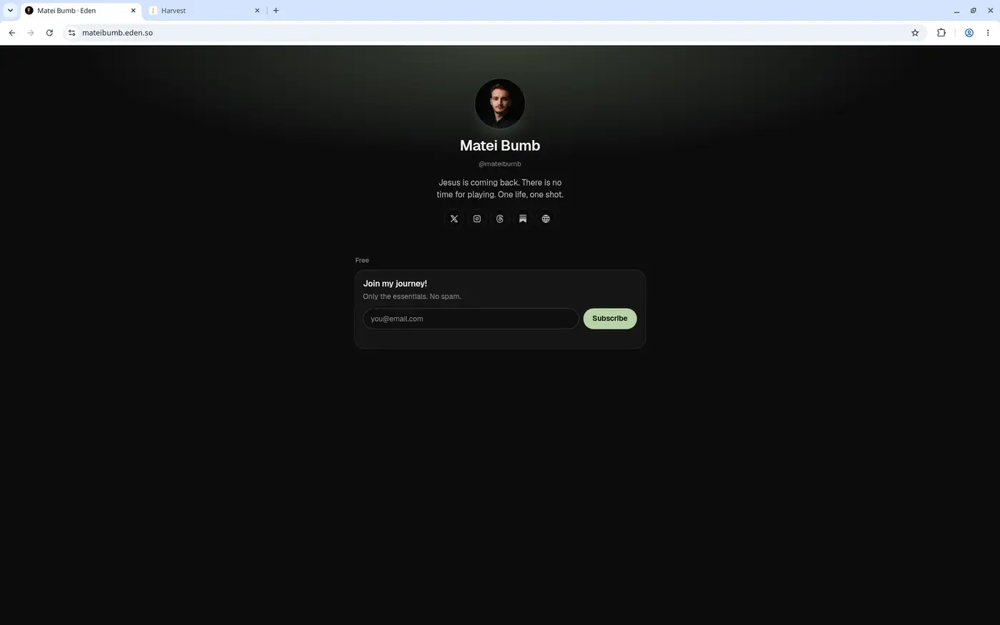 Eden reference (design we copy) — desktop</td>
</tr></table>

All 19 Eden reference screens are in `docs/prd/screenshots/11-link-in-bio/` (see
`_manifest.json`) — the public storefront, marketing links list, and the full storefront/
link-in-bio editor scroll (themes, blocks, accent).

### 11.14 Open questions
See [§21](#21-open-questions-for-matei) items tagged **LinkInBio**.

---
